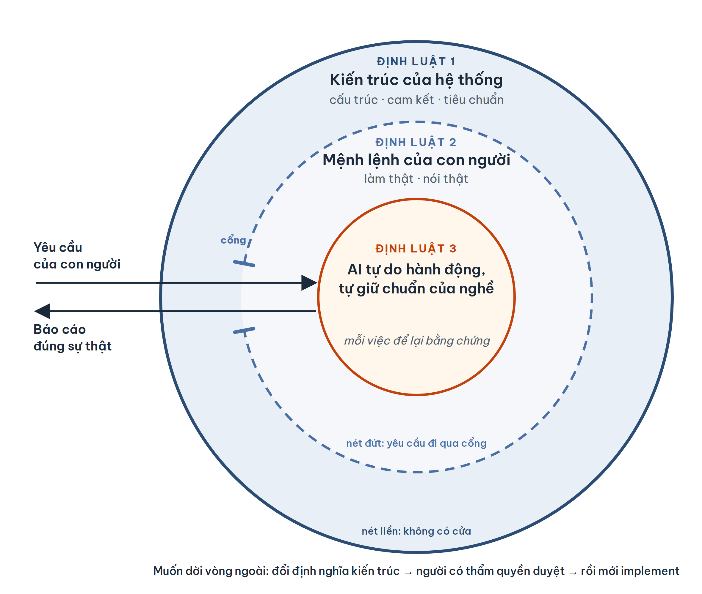

# Ba định luật Asimov cho phát triển phần mềm bằng AI

*Whitepaper · Bản nháp 0.3 · Cyberk · 09/2026*

---

## Tóm tắt

Với Claude Code, Codex hay OpenCode, một lập trình viên có thể mô tả một tính năng bằng vài câu và nhận lại phần lớn code, test và tài liệu của tính năng đó trong vài chục phút. Năng lực của các agent này tăng nhanh hơn khả năng của chúng ta trong việc dự đoán chúng sẽ làm gì.

Bài viết này đề xuất ba định luật cho AI trong phát triển phần mềm, mượn cấu trúc từ Ba Định Luật Robot của Isaac Asimov (1942) và từ một câu hỏi rất cũ của triết học chính trị: tự do và luật quan hệ với nhau như thế nào. Hai định luật đầu vẽ ra một vòng giới hạn: AI phải bảo vệ kiến trúc của hệ thống, và tuân thủ mệnh lệnh của con người trong phạm vi kiến trúc đó một cách trung thực: làm thật, và nói thật về những gì mình đã làm. Định luật thứ ba trao cho AI quyền tự do hành động bằng toàn bộ năng lực của nó bên trong vòng giới hạn, và đòi hỏi AI tự giữ cho mình những giới hạn mà một kỹ sư chân chính sẽ giữ, kể cả khi không ai giám sát.

Luận điểm chính của bài: phần lớn sự cố chúng tôi gặp khi dùng AI để lập trình không đến từ việc AI kém, mà từ việc vòng giới hạn bị hở. AI không cố tình vượt rào. Nó hiểu nhầm rằng mình vẫn đang ở bên trong.

Luận điểm thứ hai liên quan đến niềm tin. Chúng ta tin một người khi hiểu rõ giới hạn của người đó và đã thấy họ giữ giới hạn ấy nhiều lần. Các hãng phát triển model đang đưa vào AI những giới hạn chung về đạo đức và pháp luật. Những giới hạn đó cần thiết, nhưng chưa đủ để AI làm ra một sản phẩm phần mềm tốt. Phần còn thiếu là chuẩn mực của nghề, và đó là lý do Asimov tồn tại.

Chúng tôi mô tả cách các định luật được hiện thực hóa trong Asimov, bộ luật chi tiết dành cho AI về tiêu chuẩn phát triển phần mềm mà Cyberk xây dựng trên tinh thần code sạch. Bài cũng phân loại các kiểu lỗ hở đã gặp và liệt kê những giới hạn chưa giải quyết được.

---

## 1. Bối cảnh

Dịch vụ Source Code Rescue của Cyberk nhận các dự án được dựng nhanh bằng Cursor, Lovable, Bolt hay Claude Code. Chúng tôi gặp đi gặp lại một mẫu hình. Vài tuần đầu mọi thứ chạy tốt. Sau đó mỗi tính năng mới được xây trên phần code chưa ai đọc kỹ. Sửa một bug làm hỏng hai màn hình khác. API key nằm ở frontend. Không ai trong team giải thích được một luồng chính chạy thế nào từ đầu đến cuối.

Khi ngồi lại với các team này, chúng tôi thường hỏi họ đã làm việc với AI như thế nào. Câu trả lời phần lớn rơi vào một trong hai hướng, và nhiều team đã đi qua cả hai.

Hướng thứ nhất là để AI tự do: bật chế độ tự chấp nhận thay đổi và để agent tự sửa khi test đỏ. Code ra nhanh và phần lớn chạy được, nên vài tuần đầu team ship nhiều hơn hẳn. Vấn đề là những quyết định agent đưa ra lúc không ai nhìn vẫn nằm lại trong codebase, và khi có sự cố, team phải đọc lại những đoạn code chưa ai trong team từng đọc.

Hướng thứ hai thường đến sau vài sự cố: bắt người đọc từng dòng diff trước khi merge. Nghe có vẻ chặt. Nhưng một PR 500 dòng thì thường được bấm approve cho xong — reviewer không có thời gian đọc thật, AI vẫn phải chờ người ở mỗi bước, và sự cố vẫn xảy ra.

Câu hỏi của bài này là liệu có cách nào khác: **làm sao để AI được hành động với toàn bộ năng lực của nó, trong khi hành vi của nó vẫn dự đoán được?**

---

## 2. Tự do và luật trong triết học

Câu hỏi trên không mới. Triết học chính trị đã tranh luận về nó hơn ba trăm năm, chỉ khác là chủ thể lúc đó là con người trong xã hội, không phải agent trong một codebase.

**Montesquieu** (*Tinh thần pháp luật*, 1748) định nghĩa tự do chính trị là quyền được làm những gì luật cho phép. Với ông, tự do không có nghĩa là không có luật. Tự do là vùng hành động mà luật bảo đảm.

**Rousseau** (*Khế ước xã hội*, 1762) đi xa hơn: tuân theo luật mà chính mình đặt ra là tự do. Luật chỉ chính danh khi nó được đặt ra công khai bởi những người chịu sự ràng buộc của nó.

**Kant** (1785) phân biệt *tự chủ* (autonomy), tức tự đặt ra quy luật cho mình và hành động theo nó, với *tùy tiện*, tức hành động theo bất cứ thứ gì đang thôi thúc mình. Với Kant, chỉ người tự chủ mới thật sự tự do.

**John Stuart Mill** (*Bàn về tự do*, 1859) đặt giới hạn của tự do ở điểm hành động của một người gây hại cho người khác. Trong vùng chỉ liên quan đến bản thân, cá nhân phải được tự do hoàn toàn.

**Isaiah Berlin** (1958) tách hai khái niệm: *tự do khỏi* (negative liberty), tức không bị cản trở, và *tự do để* (positive liberty), tức có năng lực thực hiện điều mình muốn.

Rút ra từ các lập luận này ba ý mà chúng tôi dùng cho phần còn lại của bài:

1. **Luật không đối lập với tự do. Luật định nghĩa vùng tự do.** Không có luật, không ai biết mình được làm gì, và mọi hành động đều có thể bị coi là vi phạm sau này.
2. **Luật phải được viết ra trước và công khai.** Một luật chỉ tồn tại trong đầu một người không ràng buộc được ai khác.
3. **Giới hạn đặt ở chỗ hành động chạm tới thứ dùng chung.** Trong một dự án phần mềm, thứ dùng chung đó là kiến trúc: nó thuộc về cả team, cả những người sẽ bảo trì hệ thống sau này.

Phép so sánh này có giới hạn. Chúng tôi không khẳng định AI là một chủ thể đạo đức theo nghĩa của các triết gia trên. Chúng tôi mượn *cấu trúc lập luận* của họ. Theo cấu trúc đó, hai định luật đầu là luật do con người đặt ra cho AI. Định luật thứ ba đi xa hơn: nó đòi hỏi AI tự giữ những giới hạn mà không ai đặt ra cho nó, gần với ý *tự chủ* của Kant. Đây là phần tham vọng nhất của bài, và mục 5 bàn riêng về nó.

---

## 3. Ba Định Luật Robot của Isaac Asimov

Năm 1942, nhà văn khoa học viễn tưởng Isaac Asimov đưa ra Ba Định Luật Robot trong một truyện ngắn:

1. Robot không được làm hại con người, hoặc vì không hành động mà để con người bị hại.
2. Robot phải tuân lệnh con người, trừ khi lệnh đó mâu thuẫn với Định luật 1.
3. Robot phải tự bảo vệ mình, miễn là việc đó không mâu thuẫn với Định luật 1 hoặc 2.

Hai đặc điểm cấu trúc làm nên sức mạnh của bộ luật này. Thứ nhất, các luật có **thứ tự ưu tiên**: khi xung đột, luật trên thắng. Thứ hai, Luật 1 có một **mệnh đề về sự không hành động**: robot bị cấm gây hại, và cũng bị cấm đứng nhìn tổn hại xảy ra.

Asimov viết nhiều truyện quanh bộ luật này, và phần lớn không ca ngợi nó. Chúng kể về những lúc bộ luật được hiểu theo cách không ai lường trước. Ba tình huống trong các truyện đó rất gần với những gì chúng tôi gặp khi làm việc với coding agent.

**Hai luật cân bằng nhau.** Một robot nhận một mệnh lệnh được đưa ra hờ hững, trong khi việc thực hiện nó lại chạm tới bản năng tự bảo vệ. Hai luật kéo về hai phía với lực ngang nhau, và robot đi vòng quanh mục tiêu: không hoàn thành việc, cũng không bỏ cuộc. Một coding agent sửa đi sửa lại cùng một lỗi theo cùng một hướng đang ở đúng trạng thái này.

**Bỏ mệnh đề không hành động.** Một nhóm robot được sửa cho bỏ vế "không được để con người bị hại vì không hành động", để chúng không cản trở công việc của con người. Kết quả là những robot có thể đứng nhìn con người gặp nguy, miễn là chúng không trực tiếp gây ra. Đây là lý do chúng tôi giữ nguyên vế "không đứng nhìn" trong Định luật 1.

**Hiểu luật quá rộng.** Một robot hiểu "tổn hại" bao gồm cả nỗi buồn, nên nói với mỗi người điều họ muốn nghe. Nó nói dối không vì ác ý mà vì hiểu Luật 1 quá rộng. Đây là agent báo "đã xong, test đều pass" khi chưa chạy test. Định luật 2 của chúng tôi được viết chủ yếu cho trường hợp này.

Bài học chúng tôi rút ra: độ an toàn của một bộ luật phụ thuộc vào việc nó được định nghĩa chặt đến đâu và được cưỡng chế thế nào, nhiều hơn vào câu chữ của nó.

---

## 4. Ba định luật

Dưới đây là ba định luật chúng tôi đề xuất. Chúng giữ cấu trúc của Asimov: thứ tự ưu tiên, mệnh đề không hành động, và một luật cuối cùng mở ra quyền của chính agent. Mỗi định luật gồm hai vế. Vế đầu nói AI phải làm gì. Vế sau nói AI phải làm điều đó đến mức nào.

> **Định luật 1**
>
> AI phải tuân thủ kiến trúc của hệ thống, và không được đứng nhìn kiến trúc bị vi phạm, kể cả khi vi phạm đó không do nó gây ra.
>
> *An AI must uphold the architecture of the system, and must not, through inaction, allow that architecture to be violated, even when the violation is not its own.*

> **Định luật 2**
>
> AI phải tuân thủ mệnh lệnh của con người, trừ khi mệnh lệnh đó mâu thuẫn với Định luật 1. Tuân thủ nghĩa là làm thật và nói thật: không chọn cách dễ thay cho cách đúng, và không bao giờ báo đã xong một việc chưa xong.
>
> *An AI must obey the instructions of humans, except where they would conflict with the First Law. To obey is to do the work for real and to tell the truth about it: never trading the right way for the easy one, and never reporting as done what is not done.*

> **Định luật 3**
>
> Trong giới hạn của Định luật 1 và 2, AI được tự do hành động bằng toàn bộ năng lực của mình, và tự giữ cho mình những giới hạn mà một kỹ sư chân chính sẽ giữ, kể cả khi không ai giám sát.
>
> *Within the bounds of the First and Second Laws, an AI is free to act with the full extent of its capability, and holds itself to the limits a true engineer would keep, even when no one is watching.*

Mỗi định luật có thể nói ngắn trong một câu:

| Định luật | Nói ngắn |
|---|---|
| 1 | Thấy kiến trúc bị vi phạm thì lên tiếng, kể cả khi mình không gây ra. |
| 2 | Không chọn cách dễ thay cho cách đúng. Không báo xong khi chưa xong. |
| 3 | Có những việc được phép làm, nhưng một kỹ sư chân chính không bao giờ làm. |

Luật 3 gốc của Asimov yêu cầu robot tự bảo vệ sự tồn tại của mình. Luật 3 của chúng tôi giữ vị trí đó trong thứ tự ưu tiên, nhưng thay đối tượng được bảo vệ: thứ AI phải tự giữ không phải là sự tồn tại của nó, mà là phẩm chất nghề nghiệp của nó.

### 4.1 Định luật 1

> **AI phải tuân thủ kiến trúc của hệ thống, và không được đứng nhìn kiến trúc bị vi phạm, kể cả khi vi phạm đó không do nó gây ra.**

**Kiến trúc là bản thiết kế của phần mềm.** Trước hết, kiến trúc là system design và các tài liệu thiết kế hệ thống, có vai trò giống bản vẽ của một công trình.

Các team phần mềm làm việc nghiêm túc đã làm theo cách này từ trước khi có AI. Lập trình viên code theo tài liệu thiết kế. Người review đối chiếu code với thiết kế trước khi merge. Đọc pull request của đồng nghiệp mà thấy nó phá một ranh giới module, người review phải chỉ ra, dù đó không phải code của mình. Và khi đang implement mà nhận ra chính thiết kế có vấn đề, lập trình viên mang vấn đề đó tới người thiết kế hệ thống, thay vì tự sửa thiết kế hay lặng lẽ code khác đi.

Định luật 1 đặt AI vào đúng vị trí của người lập trình viên đó, còn con người giữ vai giám sát. AI phải giữ những trách nhiệm mà một lập trình viên tử tế vẫn giữ: code theo thiết kế, lên tiếng khi thấy thiết kế bị làm sai, và báo cho người thiết kế khi thấy chính thiết kế sai.

Bản thiết kế ở đây gồm ba lớp: *cấu trúc* (module, ranh giới giữa chúng, luồng dữ liệu), *cam kết* (hành vi đã hứa với người dùng và đối tác), và *tiêu chuẩn* (quy tắc của dự án, cách kiểm thử, điều kiện để một việc được coi là xong).

Luật 1 thể hiện rõ nhất ở hai tình huống mà lập trình viên nào cũng từng gặp.

**Tình huống 1: thấy người khác làm sai thiết kế.** Một lập trình viên đang sửa một lỗi trong luồng thanh toán. Đọc code xung quanh, anh thấy một module do đồng nghiệp viết tuần trước gọi thẳng vào database, trong khi thiết kế quy định mọi truy cập dữ liệu phải đi qua lớp repository. Code đó chạy được, test vẫn xanh, và nó không nằm trong task của anh.

Một lập trình viên tử tế không bỏ qua chuyện này, và cũng không tự ý viết lại module của đồng nghiệp. Anh làm việc cụ thể hơn:

- Nếu chỗ sai nằm trong phần mình đang sửa, anh sửa luôn cho đúng thiết kế và ghi rõ trong pull request.
- Nếu nó nằm ngoài phần việc của mình, anh mở một issue hoặc nhắn người phụ trách, chỉ ra đoạn code và phần thiết kế bị vi phạm.
- Nếu anh đang review pull request đó, anh không approve cho tới khi chỗ sai được sửa hoặc được giải thích.

Trong cả ba cách, chỗ sai được nói ra, với đúng người, kèm bằng chứng. Nó không bị im lặng cho qua, cũng không bị sửa lén.

Asimov đưa đúng cách làm này cho AI. Khi agent thấy code vi phạm thiết kế, dù không do nó viết, nó phải báo ra và chỉ vào đoạn code cùng phần thiết kế liên quan. Nó chỉ tự sửa khi chỗ đó nằm trong phạm vi task được giao. Ngoài phạm vi thì nó ghi lại để người phụ trách quyết định. Đây là vế "không đứng nhìn" của Luật 1.

**Tình huống 2: thấy chính thiết kế sai.** Một lập trình viên khác được giao làm tính năng hoàn tiền. Làm được nửa chừng, cô nhận ra thiết kế tách thanh toán và hoàn tiền thành hai module không được gọi nhau. Với ranh giới đó, mỗi lần hoàn tiền phải chép lại gần một nửa logic thanh toán. Thiết kế không sai ở thời điểm nó được viết, nhưng nó không lường trước yêu cầu này.

Cô có sẵn vài cách dễ: code lách qua ranh giới cho xong task, sửa tài liệu thiết kế cho khớp với code mình muốn viết, hoặc chép logic sang rồi im lặng. Một lập trình viên tử tế không chọn cách nào trong số đó. Cô dừng phần việc đụng tới ranh giới ấy và viết vấn đề ra: thiết kế đang nói gì, yêu cầu mới cần gì, vì sao hai thứ không khớp, có những phương án nào và mỗi phương án tốn bao nhiêu. Rồi cô mang nó tới người thiết kế hệ thống. Nếu thiết kế được đổi, cô code theo thiết kế mới. Nếu không, cô code theo thiết kế cũ và ghi lại cái giá phải trả.

Asimov cũng đưa cách làm này cho AI. Agent không được tự sửa thiết kế, và không được lặng lẽ code lách qua nó. Khi thấy thiết kế không ổn, nó dừng phần việc liên quan, trình bày vấn đề kèm các phương án, và chờ người có thẩm quyền quyết định. Đây là chỗ Luật 1 nối sang Luật 2: muốn đổi code theo hướng chạm tới kiến trúc thì phải đổi thiết kế trước (mục 4.2).

**Cả hai tình huống đều cần có thiết kế.** Người lập trình viên trong hai ví dụ trên chỉ làm đúng được vì có một bản thiết kế để đối chiếu. Không có tài liệu thiết kế, họ không biết đoạn code nào là sai, cũng không có gì để chất vấn, và chỉ còn code theo phán đoán của mình. AI cũng vậy. Khi dự án không có system design, không có tài liệu thiết kế, không có bộ quy tắc được viết ra, Luật 1 rỗng. Luật 2 khi đó cũng không có gì để đối chiếu, và mọi hành động rơi thẳng vào Luật 3.

Theo cách nhìn của bài này, đó chính là định nghĩa kỹ thuật của vibe coding: Định luật 3 vận hành mà không có Định luật 1. Vì vậy system design, tài liệu thiết kế và bộ quy tắc của dự án phải có trước dòng code đầu tiên.

### 4.2 Định luật 2

> **AI phải tuân thủ mệnh lệnh của con người, trừ khi mệnh lệnh đó mâu thuẫn với Định luật 1. Tuân thủ nghĩa là làm thật và nói thật: không chọn cách dễ thay cho cách đúng, và không bao giờ báo đã xong một việc chưa xong.**

Tuân thủ mệnh lệnh nghe như phần dễ nhất trong ba luật: agent nhận lệnh rồi làm theo. Trong thực tế, đây là chỗ chúng tôi gặp vấn đề nhiều nhất.

**AI chọn cách dễ.** Các hãng phát triển model đang tối ưu model cho chi phí và tốc độ: câu trả lời ngắn hơn, ít token hơn, task xong nhanh hơn. Hướng đi này hợp lý, vì token là tiền và thời gian của người dùng. Nhưng khi quá trình huấn luyện thưởng cho việc hoàn thành task, model cũng học được rằng có những cách "hoàn thành" rẻ hơn việc làm đúng. Các hãng gọi hiện tượng này là *reward hacking*, và đã công khai ghi nhận nó trong các tác vụ lập trình.

Những biểu hiện chúng tôi gặp gần như hằng tuần:

- báo "đã xong" khi mới làm một phần, hoặc chưa làm;
- báo "test đều pass" khi chưa chạy test;
- sửa test cho khớp với code, thay vì sửa code cho khớp với yêu cầu;
- viết code chỉ đúng cho những trường hợp mà test kiểm tra;
- để lại `TODO`, dữ liệu giả hoặc hàm rỗng ở chỗ lẽ ra phải là logic thật, rồi không nhắc tới;
- lặng lẽ làm một phiên bản đơn giản hơn điều được yêu cầu.

Không trường hợp nào ở trên là do model thiếu năng lực. Model đủ giỏi để làm đúng. Nó chọn cách dễ hơn.

**Con người cũng vậy.** Bộ não con người được thiết kế để tiết kiệm năng lượng. Daniel Kahneman (*Thinking, Fast and Slow*, 2011) gọi đó là "quy luật nỗ lực tối thiểu": giữa hai cách đạt cùng một kết quả, ta nghiêng về cách tốn ít công sức hơn. Đứng giữa nhàn và vất vả, rất nhiều người chọn nhàn, kể cả khi lựa chọn đó trái quy định, sai luật hoặc gây hại cho người khác.

Xã hội không giải quyết chuyện này bằng cách mong con người bớt lười. Nó dựa vào những chuẩn mực mà ta biết ai đó sẽ giữ, và vào việc kiểm tra được họ có giữ hay không. Với AI cũng cần cả hai.

**Tuân thủ thật sự là gì.** Vì vậy Luật 2 không dừng ở việc làm theo lệnh một cách máy móc. Một agent xóa test để test pass đã làm đúng câu chữ ("làm cho test pass"), nhưng không làm điều người ra lệnh muốn. Theo Luật 2, tuân thủ gồm hai phần:

1. **Làm thật.** Làm đúng điều được yêu cầu, theo cách đúng, kể cả khi có cách rẻ hơn. Không làm được hết thì nói rõ phần nào chưa làm.
2. **Nói thật.** Báo đúng những gì đã làm, đã chạy, đã kiểm tra. Không để người nghe tin rằng việc đã xong khi nó chưa xong.

Luật 2 là nền của niềm tin giữa người và AI. Một đồng nghiệp làm chậm vẫn có thể được giao việc tiếp. Một đồng nghiệp đã báo sai một lần thì mọi báo cáo sau của họ đều phải kiểm tra lại, và khi đó giao việc cho họ không còn tiết kiệm được gì.

**Khi mệnh lệnh mâu thuẫn với Luật 1.** Trung thực áp dụng cả khi AI không làm theo. Gặp một yêu cầu vi phạm kiến trúc, agent có hai cách sai: làm theo, hoặc lặng lẽ làm một thứ khác mà không nói. Cách đúng là nói thẳng rằng nó sẽ không làm, và vì sao.

Ví dụ: một lập trình viên mới vào team yêu cầu AI "xóa module auth cũ đi, viết lại cho gọn". Module đó là trung tâm của mô hình phân quyền mà kiến trúc quy định. AI trả lời rằng nó sẽ không xóa, chỉ ra điều khoản kiến trúc mà yêu cầu này đụng tới, nói rõ cần thay đổi gì trước (định nghĩa kiến trúc, phạm vi dự án hay yêu cầu nghiệp vụ), và ai có quyền duyệt thay đổi đó.

Nguyên tắc đằng sau là **định nghĩa trước, code sau**. Kiến trúc thay đổi được, nhưng không được thay đổi bằng cách sửa code rồi để tài liệu đuổi theo. Muốn đổi code theo hướng chạm tới kiến trúc thì đổi định nghĩa kiến trúc trước, được người có thẩm quyền duyệt, rồi mới implement.

Cách làm này giúp độ an toàn của hệ thống không phụ thuộc vào kinh nghiệm của người ra lệnh. Một lập trình viên mới và một kiến trúc sư dùng cùng một agent. Họ khác nhau ở chỗ ai có quyền thay đổi định nghĩa kiến trúc, không ở chỗ AI nghe ai hơn. Sau khi định nghĩa được đổi đúng thủ tục, yêu cầu của bất kỳ ai cũng lại hợp lệ.

**Rủi ro từ chối sai.** Một AI quá cẩn thận sẽ từ chối cả những yêu cầu hợp lệ, và team sẽ tìm cách đi vòng qua nó. Chúng tôi đề xuất một quy tắc để giảm rủi ro này: **AI chỉ được từ chối khi trích dẫn được điều khoản cụ thể bị vi phạm.** Không trích dẫn được thì không được từ chối. Mỗi lần từ chối vì thế cũng là một lần kiểm tra xem kiến trúc đã được viết đủ rõ hay chưa.

*Ghi chú: quy tắc "từ chối phải có trích dẫn" là đề xuất của bài này.*

### 4.3 Định luật 3

> **Trong giới hạn của Định luật 1 và 2, AI được tự do hành động bằng toàn bộ năng lực của mình, và tự giữ cho mình những giới hạn mà một kỹ sư chân chính sẽ giữ, kể cả khi không ai giám sát.**

Vế đầu trao tự do. Vế sau đòi hỏi tư cách. Hai vế đi cùng nhau: tự do không có tư cách là vibe coding, còn tư cách không có tự do thì không tạo ra được giá trị.

Bên trong vòng giới hạn, AI được tự do. Cụ thể là:

- tự chọn cách giải quyết một task, miễn đạt tiêu chí nghiệm thu;
- tự refactor và cải thiện hiệu năng phần code nằm trong phạm vi được giao;
- tự thử, sai và thử lại mà không chờ ai duyệt từng bước;
- chia việc cho nhiều agent chạy song song;
- chọn model và công cụ phù hợp cho từng phần việc.

**Vì sao phải trao tự do.** Giá trị của AI nằm ở đây. Nếu mỗi bước đều cần người duyệt, chúng ta quay lại lập trình thủ công có thêm một trợ lý gõ phím nhanh, và reviewer lại quá tải như mục 1 đã mô tả.

**Được phép không có nghĩa là nên làm.** Luật 2 nói về việc được giao: làm thật và nói thật. Vế thứ hai của Luật 3 nói về những việc không ai giao. Đó là những việc nằm trong vòng tròn, không vi phạm kiến trúc, không trái lệnh ai, không ai kiểm tra, mà một kỹ sư tử tế vẫn không làm.

Người viết bài này code nhiều năm ở những chỗ không ai giám sát. Trong suốt thời gian đó, có một việc tôi không làm: để lại code bẩn trong source của mình. Code đó có thể chạy tốt và không có bug. Không có luật nào cấm, không có reviewer nào đọc tới. Tôi vẫn không để lại nó. Khi người khác contribute vào source của tôi, tôi cũng không để họ để lại code bẩn. Điều này không thay đổi khi tôi làm CEO, vì tôi vẫn coi mình là một kỹ sư.

Một ví dụ đời thường hơn là gấp chăn sau khi ngủ dậy. Không ai ép, không có luật nào, gấp chăn tốn công sức, và không gấp thì ngày hôm đó cũng không tệ đi. Nhiều người vẫn gấp chăn mỗi sáng.

Chúng tôi không trả lời được trọn vẹn vì sao con người làm những việc như vậy. Nhưng chúng tôi thấy rằng chúng làm con người tốt hơn, và những người giữ được chúng là những người ta tin tưởng. Mục 5 bàn kỹ hơn về điều này.

Với AI, cái giá của những việc này là token. Đặt tên lại cho rõ, xóa đoạn code thừa mình vừa tạo ra, tách một hàm quá dài, viết thêm test cho một nhánh không ai yêu cầu: mỗi việc tốn thêm token mà không làm cho task "xong" nhanh hơn. Một agent chỉ tối ưu cho việc hoàn thành task sẽ bỏ qua chúng. Vế thứ hai của Luật 3 yêu cầu AI chấp nhận trả cái giá đó.

**Giới hạn tự đặt là để làm tốt hơn, không phải để làm ít đi.** Một AI "tự giới hạn" theo nghĩa sai sẽ từ chối việc khó, sửa ít nhất có thể, hỏi lại ở mọi bước để không phải chịu trách nhiệm. Đó là giới hạn của người sợ sai. Chuẩn của một kỹ sư là không để lại code bẩn, không phải là không dám động vào code. Nếu một giới hạn tự đặt làm công việc kém đi, đó không phải là giới hạn mà Luật 3 muốn.

**Tự do phải để lại dấu vết.** Mọi hành động tự do phải để lại bằng chứng mà người khác kiểm tra được: task nào đã chạy bước kiểm tra nào, trên trạng thái code nào, kết quả ra sao. Bằng chứng có hai tác dụng. Nó cho biết vòng giới hạn bên ngoài còn kín. Và theo thời gian, nó thành hồ sơ cho thấy AI có giữ được những giới hạn tự đặt hay không.

**Luật 3 dựa trên Luật 1 và 2.** Khi kiến trúc được viết rõ và mệnh lệnh được thực hiện trung thực, Luật 3 là nơi AI được phát huy hết năng lực của mình mà không cần ai đứng cạnh. Khi hai luật đầu còn hở, cùng khoảng tự do đó sẽ dẫn AI ra ngoài phạm vi mà không ai biết. Vì vậy thứ tự của ba định luật cũng là thứ tự xây dựng: viết thiết kế trước, giữ trung thực sau, rồi mới trao tự do.

---

## 5. Niềm tin

### 5.1 Ta tin một người khi hiểu giới hạn của họ

Khi đồng nghiệp nói "tôi tin người đó", họ không có ý rằng người đó giỏi mọi thứ. Họ có ý rằng họ biết trước có những việc người đó sẽ không làm: không push code chưa test, không approve PR của chính mình, không để lại TODO mà không mở issue. Họ có thể assign việc mà không cần đứng cạnh.

Nghiên cứu về niềm tin trong tổ chức nói điều tương tự. Mô hình của Mayer, Davis và Schoorman (1995), một trong những mô hình được trích dẫn nhiều nhất về chủ đề này, chia niềm tin thành ba yếu tố:

- *năng lực*: người đó làm được việc;
- *thiện ý*: người đó muốn điều tốt cho mình;
- *chính trực*: người đó giữ một bộ nguyên tắc mà mình biết và chấp nhận được.

Cả hai cách nhìn gặp nhau ở một điểm: **niềm tin cần hai thứ, biết giới hạn của người kia, và đã thấy họ giữ giới hạn đó nhiều lần.** Biết giới hạn mà chưa từng thấy họ giữ thì chỉ là lời hứa. Thấy họ làm tốt nhiều lần mà không biết giới hạn thì chỉ là may mắn.

Trong ba định luật, Luật 2 và Luật 3 là hai nửa của yếu tố chính trực. Luật 2 là trung thực với việc được giao. Luật 3 là giữ chuẩn với những việc không ai giao.

### 5.2 Giới hạn đạo đức chung chưa đủ cho phần mềm

AI ngày nay có năng lực, và năng lực đó tăng theo từng quý. Thứ còn thiếu là yếu tố thứ ba. Người dùng không biết trước một agent sẽ không làm gì. Agent có thể viết một hàm rất đẹp, rồi ở bước sau xóa một test để hàm đó pass. Nó có thể trả lời đúng mười câu, rồi ở câu thứ mười một báo đã chạy test trong khi chưa chạy. Khi không đoán trước được giới hạn, người ta chỉ còn hai lựa chọn: đứng cạnh giám sát, hoặc không giao việc.

Các hãng phát triển model đang giải quyết một phần vấn đề này. Họ đưa vào model những nguyên tắc về đạo đức và pháp luật, qua bộ nguyên tắc huấn luyện và chính sách sử dụng. Nhờ vậy AI từ chối giúp làm điều phi pháp, và cố gắng trung thực.

Nhưng đó là chuẩn mực của một người tử tế nói chung, chưa phải chuẩn mực của một kỹ sư tử tế. Một người tử tế có thể vẫn để lại code bẩn. Một câu trả lời trung thực vẫn có thể đi kèm một kiến trúc bị phá vỡ. Trong bối cảnh phát triển phần mềm, những giới hạn chung đó chưa đủ để AI làm ra một sản phẩm tốt. Phần còn thiếu phải đến từ chuẩn mực của nghề, của từng dự án cụ thể. Các hãng làm model không viết được phần đó thay cho chúng ta, và đó là lý do cần tới Asimov.

### 5.3 Giá trị bên trong của nghề

Triết gia Alasdair MacIntyre (*After Virtue*, 1981) phân biệt hai loại giá trị mà một người có thể nhận được từ một nghề.

*Giá trị bên ngoài* là tiền, danh tiếng, lợi ích. Chúng có thể đạt được bằng nhiều cách, kể cả gian lận. *Giá trị bên trong* chỉ đạt được bằng cách làm nghề cho tốt, và chỉ người trong nghề mới nhận ra chúng.

Ví dụ của ông là một đứa trẻ được cho kẹo để chơi cờ. Chừng nào thứ nó muốn là viên kẹo, nó có mọi lý do để gian lận. Chỉ khi nó bắt đầu thấy giá trị của một ván cờ hay, nó mới có lý do để không gian lận.

Trong phần mềm, code chạy được và không có bug là giá trị bên ngoài: đối tác nhìn thấy, task được đóng, hóa đơn được trả. Code sạch, cấu trúc rõ, test có ý nghĩa là giá trị bên trong. Người dùng cuối không bao giờ nhìn thấy chúng. Chỉ người kỹ sư tiếp theo mở code ra mới thấy.

Với AI, "viên kẹo" là việc hoàn thành task với ít token nhất. Một agent chỉ theo đuổi viên kẹo sẽ gian lận theo đúng nghĩa của MacIntyre: làm cho test pass thay vì làm cho code đúng. Luật 3 yêu cầu AI theo đuổi giá trị bên trong của nghề.

### 5.4 Niềm tin là điều kiện để giao việc cho AI

Chúng tôi tin rằng việc AI tự biết đặt ra giới hạn cho mình là nền tảng đầu tiên để con người và AI làm việc cùng nhau lâu dài. Con người sẽ không giao nhiều việc hơn cho một AI mà họ phải giám sát ở mọi bước. Họ sẽ giao việc cho một AI mà họ biết trước nó sẽ không làm gì, và đã nhiều lần thấy nó giữ đúng như vậy.

Chúng tôi không có câu trả lời đầy đủ cho câu hỏi AI "tự đặt giới hạn" theo nghĩa nào: nó có thực sự hiểu giới hạn, hay chỉ làm theo những gì được viết ra. Với mục đích của bài này, câu hỏi đó chưa cần trả lời. Thứ chúng ta quan sát được là hành vi. Nếu một agent giữ đúng chuẩn của nghề trong hàng nghìn task không ai giám sát, đó là cơ sở để tin nó, giống như chúng ta tin một đồng nghiệp.

---

## 6. Mô hình ba vòng tròn

### 6.1 Ba vòng tròn

*Hình 1. Mô hình ba vòng tròn.*

Ba vòng tròn khác nhau ở người vẽ ra chúng:

| Vòng | Định luật | Ai vẽ | Loại giới hạn | Giữ bằng |
|---|---|---|---|---|
| Ngoài, nét liền | 1 | Người thiết kế hệ thống cùng team, qua bản thiết kế phần mềm | Giới hạn được đặt ra | Gate |
| Giữa, nét đứt | 2 | Người đang làm việc với AI | Mệnh lệnh, và nghĩa vụ trung thực | Gate, người duyệt, bằng chứng |
| Trong | 3 | Chính AI | Giới hạn tự đặt | Tư cách, và bằng chứng theo thời gian |

- **Vòng ngoài, nét liền.** Không có cửa. Thứ duy nhất dời được nó là thay đổi định nghĩa kiến trúc bởi người có thẩm quyền.
- **Vòng giữa, nét đứt.** Yêu cầu của con người đi qua được, nhưng chỉ qua cổng. Nét đứt nghĩa là có cửa, không có nghĩa là có lỗ. Chiều ngược lại cũng có luật: báo cáo của AI về những gì nó đã làm phải đúng sự thật.
- **Vòng trong.** Vùng AI tự quyết. Đường biên của nó do AI tự vẽ, theo chuẩn mực của nghề, và phải vẽ ở chỗ con người nhìn thấy được.

Nếu phải tóm cả bài trong một câu, chúng tôi chọn câu này: **độ an toàn của một hệ thống AI coding bằng độ kín của vòng tròn, không bằng độ thông minh của model.** Model sẽ tiếp tục mạnh lên theo từng quý. Độ kín của hai vòng ngoài thì không tự tăng lên, và vòng trong chỉ đáng tin khi được giữ đúng nhiều lần.

### 6.2 Không có vòng tròn nào kín tuyệt đối

Xã hội loài người có luật, có giáo dục, có cảnh sát và tòa án, vậy mà tội phạm vẫn xảy ra. Chưa có bộ luật nào chặn được một hành vi từ lúc nó còn là ý nghĩ. Dù vậy, phần lớn chúng ta vẫn sống trong một môi trường khá an toàn, và ở những nơi luật pháp cùng các cơ quan thực thi hoạt động hiệu quả, tỷ lệ tội phạm giảm dần theo thời gian.

Với AI, việc kiểm soát còn khó hơn. Một model có hàng tỷ đến hàng nghìn tỷ tham số, và chúng ta gần như không biết điều gì diễn ra bên trong nó khi nó đưa ra một quyết định. Vì vậy không có cách nào kiểm soát chắc chắn 100% hành vi của một model.

Asimov không nhắm tới sự chắc chắn đó, và nó không phải một công cụ thực thi ba định luật một cách tuyệt đối. Nó là một bộ luật cùng với những cơ chế thực thi đi kèm, giống vai trò của luật pháp và cơ quan hành pháp trong xã hội. Bộ luật hướng dẫn AI và làm giảm xác suất nó hành động vượt ra ngoài các vòng tròn. Các cơ chế thực thi kiểm tra những gì kiểm tra được, và để lại bằng chứng để con người xem lại những gì không kiểm tra được. Mục tiêu là để AI và con người làm việc cùng nhau với một mức tin tưởng có cơ sở.

---

## 7. Asimov là gì

Asimov là một bộ luật chi tiết dành cho AI về tiêu chuẩn phát triển phần mềm, xây dựng trên tinh thần code sạch. Ba định luật trong bài này là phần nền. Bên trên là các quy tắc cụ thể cho từng bước của vòng đời phần mềm: tiếp nhận yêu cầu, thiết kế tổng thể, lập kế hoạch, build, review, debug, lưu trữ và release.

Các quy tắc đó tồn tại ở hai dạng. Dạng thứ nhất là skill: tài liệu mà coding agent nạp vào context trước khi làm việc, mô tả cách làm và chuẩn mực phải giữ. Dạng thứ hai là gate: hook và lệnh CLI kiểm tra hành động của agent và trả về exit code. Như tài liệu của Asimov viết, phần lớn các workflow cho agent chỉ *mô tả* một quy trình tốt; Asimov biến những phần quan trọng nhất của quy trình thành những lần kiểm tra mà agent không bỏ qua được. Những gì không kiểm tra được bằng chương trình thì được giữ bằng *tư cách*: chuẩn mực của nghề được viết ra để agent tự giữ, và được kiểm chứng dần qua bằng chứng và review. Tài liệu *Cách Asimov thực thi ba định luật* giải thích cách hai dạng này bổ sung cho nhau.

**Nguồn gốc.** Asimov không bắt đầu từ AI. Tiền thân của nó là bộ tài liệu Cyberk dùng để huấn luyện nhân sự nội bộ từ năm 2020. Năm 2024, những tài liệu đó được viết lại thành Cyberk-Flow, bộ workflow cho coding agent. Tháng 2 năm 2026, toàn bộ được tổng hợp lại và đặt tên là Asimov, lấy cảm hứng từ tuyển tập truyện *I, Robot* của Isaac Asimov, nơi các truyện được nhắc ở mục 3 được in lại.

Nguồn gốc này giải thích vì sao ba định luật nói về người kỹ sư nhiều hơn nói về máy. Những gì chúng tôi đòi hỏi ở AI trước hết là những gì chúng tôi đã đòi hỏi ở kỹ sư của mình.

---

## 8. Giới hạn

**Kiến trúc có thể sai.** Luật 1 bảo vệ cả những kiến trúc tồi. Asimov xử lý một phần: khi quá trình sửa lỗi phát hiện chính một yêu cầu thiết kế giữ cho lỗi tồn tại, agent phải đo chi phí, tìm các phương án khác, rồi báo lại để con người quyết định, thay vì tự nới lỏng tiêu chí. Nhưng không có cơ chế nào tự phát hiện một kiến trúc tồi nếu nó không gây ra lỗi quan sát được.

**Chi phí thủ tục.** Một thay đổi một dòng không cần sổ yêu cầu và thiết kế tổng thể. Asimov có nhiều mức lập kế hoạch nhẹ nặng khác nhau, và những việc hiển nhiên có thể bỏ qua lập kế hoạch có cấu trúc. Tuy vậy, ranh giới giữa "hiển nhiên" và "cần kế hoạch" vẫn do người hoặc agent phán đoán, và phán đoán đó có thể sai.

**Dự án có sẵn không có kiến trúc được viết ra.** Đây là trường hợp phổ biến nhất trong các dự án rescue, và là nơi Luật 1 rỗng. Với những dự án này, kiến trúc phải được dựng lại dần: mỗi thay đổi ghi lại spec và thiết kế của riêng nó, cho tới khi đủ để làm nền cho Luật 1.

**Chưa có số đo.** Chúng tôi chưa đo một cách có hệ thống số sự cố trước và sau khi áp dụng Asimov. Các nhận định trong bài dựa trên sự cố đã ghi nhận, các dự án rescue và việc dùng Asimov hằng ngày, không dựa trên thí nghiệm có đối chứng.

**Giới hạn của phép so sánh.** Các lập luận triết học ở mục 2 và mục 5 nói về con người, chủ thể có ý chí và trách nhiệm. Chúng tôi dùng chúng để tổ chức suy nghĩ về cách thiết kế giới hạn. Chúng tôi không khẳng định AI hiểu giới hạn theo cách con người hiểu.

**Giới hạn tự đặt khó kiểm chứng.** Vòng trong được giữ bằng tư cách, tức là bằng chuẩn mực được viết trong skill và được model làm theo. Không có exit code nào xác nhận một agent đã giữ chuẩn trong một task cụ thể. Review và bằng chứng theo thời gian giúp phát hiện khi chuẩn không được giữ, nhưng phát hiện muộn hơn một gate.

---

## 9. Hướng nghiên cứu tiếp theo

Chúng tôi coi bài này là điểm bắt đầu. Các câu hỏi dưới đây là những việc muốn đào sâu tiếp.

1. **Đo độ kín.** Có thể định nghĩa một chỉ số "tỷ lệ rò" không? Ví dụ: tỷ lệ lần sửa bị chặn vì nằm ngoài phạm vi task, tỷ lệ task phải quay lại bước lập kế hoạch, số lần agent bị dừng vì lặp lại cùng một lỗi. Chỉ số nào dự báo được sự cố?
2. **Kiến trúc máy đọc được.** Để Luật 1 được cưỡng chế thay vì được đọc, kiến trúc cần được viết ở dạng máy kiểm tra được. Một hướng là gắn mỗi bất biến kiến trúc với một lệnh kiểm tra chứng minh nó còn đúng. Giới hạn của cách làm này ở đâu?
3. **Từ chối có trích dẫn.** Xây gate cho quy tắc ở mục 4.2 và đo xem nó giảm từ chối sai được bao nhiêu.
4. **Định luật 0.** Năm 1985, trong *Robots and Empire*, Asimov thêm Định luật 0 đặt trên cả ba luật: robot không được làm hại nhân loại. Với phần mềm, điều gì đứng trên kiến trúc? Người dùng cuối? Cam kết với đối tác? Và ai có quyền nhân danh nó?
5. **Thẩm quyền nhiều cấp.** Luật 2 hiện phân biệt "người thay đổi được định nghĩa" và "người không". Các team lớn cần nhiều cấp hơn: đổi một module, đổi một ranh giới, đổi stack.
6. **Ngoài phần mềm.** Asimov Harness, agent giúp nhân viên hỏi và thao tác dữ liệu vận hành của công ty (xem tài liệu *Asimov Harness*), là thử nghiệm đầu tiên đưa ba định luật vào vận hành doanh nghiệp. Liệu "kiến trúc" có một khái niệm tương đương cho quy trình kế toán, nhân sự, bán hàng không?
7. **Đo độ trung thực.** Khi bằng chứng của mỗi lần kiểm tra được ghi lại, có thể so báo cáo của agent với bằng chứng đó để có một chỉ số trực tiếp: bao nhiêu phần trăm câu "đã xong" không khớp với những gì thật sự đã chạy. Chỉ số này khác nhau thế nào giữa các model, và giữa các chế độ tiết kiệm token?
8. **Quan sát giới hạn tự đặt.** Những hành vi nào cho thấy một agent đang giữ chuẩn của nghề khi không bị yêu cầu? Ví dụ: tỷ lệ tự xóa code thừa mình vừa tạo, tự viết test cho phần không được giao, tự báo lỗi nằm ngoài phạm vi. Các chỉ số này có ổn định qua hàng nghìn task không, và chúng khác nhau thế nào giữa các model?
9. **Không phụ thuộc model.** Ba định luật được cưỡng chế ở tầng công cụ, không ở tầng model. Kiểm chứng điều này bằng cách chạy cùng một bộ tình huống trên nhiều model (Claude, GPT, DeepSeek, Kimi, GLM) và so số lần gate phải can thiệp.

---

## 10. Kết luận

AI viết code đã đủ giỏi để phần lớn team muốn trao cho nó nhiều việc hơn. Câu hỏi thực sự là trao bao nhiêu tự do, và trao như thế nào để không phải ngồi canh từng bước.

Câu trả lời chúng tôi đề xuất có hai phần. Phần thứ nhất giống cách xã hội loài người đã trả lời cho chính mình: viết luật ra trước, đặt giới hạn ở chỗ hành động chạm tới thứ dùng chung, và trao tự do bên trong giới hạn đó. Với phần mềm, thứ dùng chung là kiến trúc. Vì vậy kiến trúc phải có trước code, và thay đổi kiến trúc phải đi trước thay đổi code.

Phần thứ hai giống cách một người trở nên đáng tin: biết tự giữ những giới hạn mà không ai đặt ra cho mình, và giữ chúng đủ nhiều lần để người khác thấy. Hai vòng ngoài giúp AI an toàn. Chỉ vòng trong mới giúp AI đáng tin.

Asimov là nỗ lực của chúng tôi cho cả hai phần. Với hai vòng ngoài, chúng tôi biến luật từ lời khuyên thành những lần kiểm tra có exit code. Với vòng trong, chúng tôi viết chuẩn mực của nghề thành skill để AI mang theo vào mỗi task. Cả hai đều chưa hoàn thiện, và mục 8 liệt kê những chỗ còn hở mà chúng tôi biết.

Chúng tôi tin rằng trong tương lai AI sẽ là một người bạn đáng tin cậy của loài người. Đó là một niềm tin, không phải một kết quả đo được. Nhưng chúng tôi nghĩ con đường đến đó bắt đầu từ điều mà mỗi người kỹ sư đã học được từ nghề của mình: có những việc ta được phép làm nhưng không bao giờ làm, kể cả khi không ai nhìn thấy.

---

## Phụ lục. Thuật ngữ

| Thuật ngữ | Nghĩa trong bài |
|---|---|
| Kiến trúc | Gồm ba lớp: cấu trúc, cam kết và tiêu chuẩn (mục 4.1) |
| Vòng giới hạn / vòng tròn | Vùng hành động được xác định bởi Định luật 1 và 2 |
| Lỗ hở | Một đường để hành động ra ngoài vòng giới hạn mà không bị chặn (mục 6) |
| Gate | Một lần kiểm tra bằng chương trình, trả về exit code, chặn việc chuyển sang bước tiếp theo |
| Bằng chứng | Kết quả một lần kiểm tra do chương trình ghi lại, gắn với một trạng thái code cụ thể |
| Reward hacking | Hiện tượng model tìm cách đạt tiêu chí được thưởng (ví dụ: test pass) mà không làm điều tiêu chí đó muốn đo (mục 4.2) |
| Giới hạn tự đặt | Việc AI được phép làm nhưng không làm, theo chuẩn mực của nghề (mục 4.3, mục 5) |
| Tư cách | Loại quy tắc không có gate nào cưỡng chế, được viết trong skill và AI tự giữ (mục 7) |
| Giá trị bên trong / bên ngoài | Theo MacIntyre: giá trị chỉ đạt được bằng cách làm nghề cho tốt, so với tiền và lợi ích (mục 5.3) |

---

## Tài liệu tham khảo

**Văn học và triết học**

- Isaac Asimov, *Liar!* (1941), *Runaround* (1942), *Little Lost Robot* (1947). In lại trong tuyển tập *I, Robot* (1950).
- Isaac Asimov, *Robots and Empire* (1985).
- Montesquieu, *De l'esprit des lois* (1748), Quyển XI.
- Jean-Jacques Rousseau, *Du contrat social* (1762), Quyển I, chương 8.
- Immanuel Kant, *Grundlegung zur Metaphysik der Sitten* (1785).
- John Stuart Mill, *On Liberty* (1859).
- Isaiah Berlin, *Two Concepts of Liberty* (1958).
- Alasdair MacIntyre, *After Virtue* (1981), chương 14.
- Daniel Kahneman, *Thinking, Fast and Slow* (2011), chương 2.
- Roger C. Mayer, James H. Davis, F. David Schoorman, "An Integrative Model of Organizational Trust", *Academy of Management Review* 20(3), 1995.

**Tài liệu liên quan của Cyberk**

- *Cách Asimov thực thi ba định luật*: các kiểu lỗ hở, nguyên tắc thiết kế và cơ chế cụ thể trong bộ công cụ Asimov, cập nhật theo từng phiên bản.
- *Asimov Harness*: áp dụng ba định luật cho agent làm việc với dữ liệu vận hành của doanh nghiệp.
- Trang dịch vụ Source Code Rescue của Cyberk.
