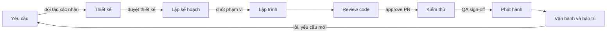
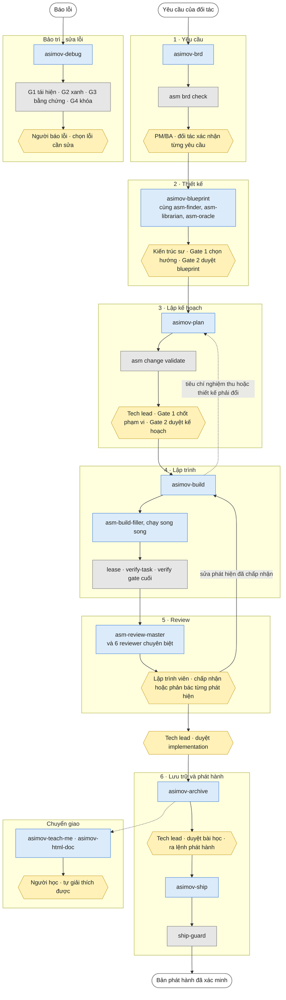
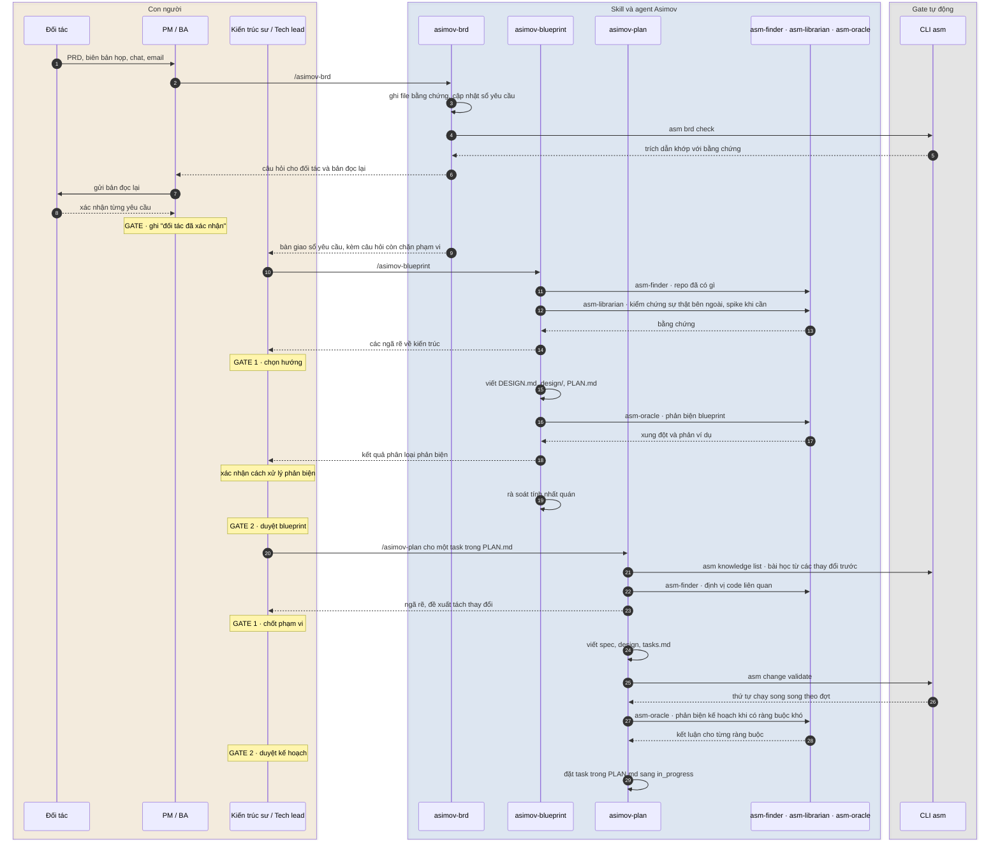
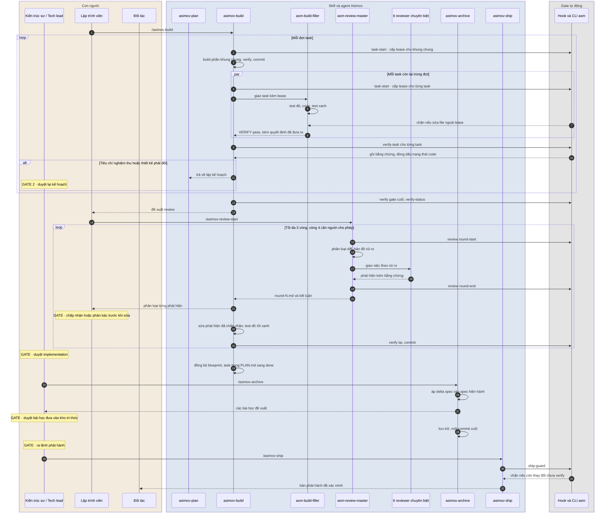
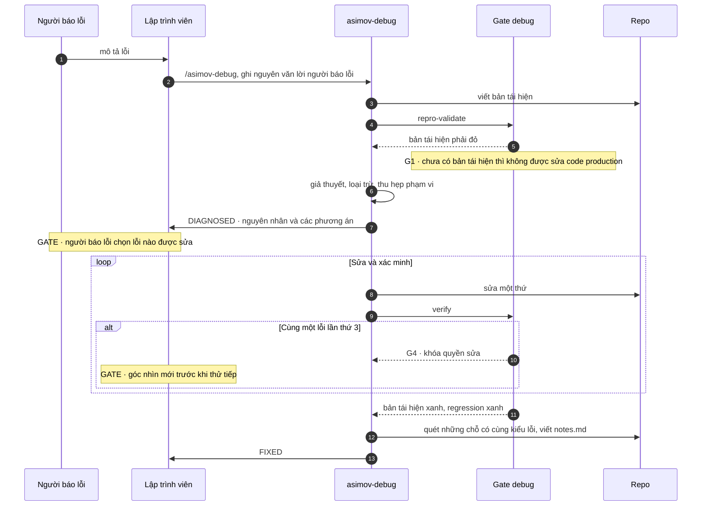
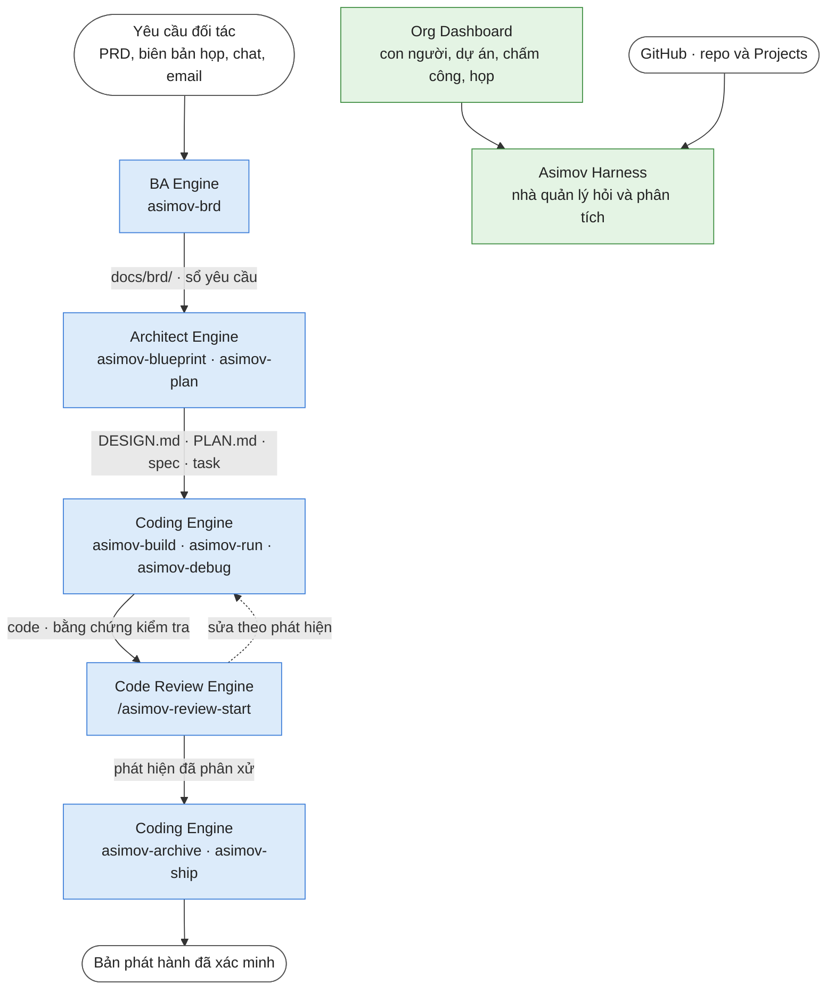
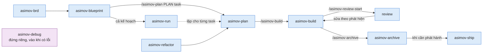

# Asimov: sản phẩm và lộ trình

*Tài liệu sản phẩm · Bản nháp 0.3 · Tình trạng tại 09/2026*

Whitepaper *Ba định luật Asimov cho phát triển phần mềm bằng AI* trình bày lý luận. Tài liệu này mô tả sản phẩm: Asimov nằm ở đâu trong vòng đời phát triển phần mềm, hiện gồm những module nào, mỗi module có những skill và lệnh nào, đang ở trạng thái nào, và sẽ đi tiếp theo hướng nào.

Người đọc chính là đối tác và lập trình viên muốn hiểu Asimov trước khi dùng thử. Phần mô tả module đủ chi tiết để đọc xong biết mỗi skill làm gì và ra kết quả gì. Hướng dẫn cài đặt và cú pháp đầy đủ nằm trong trang tài liệu của Asimov (`website/docs/`).

---

## 1. Quy trình phát triển phần mềm truyền thống

Trước khi có AI, một team phần mềm làm việc tử tế đã đi qua cùng một vòng đời (SDLC): hiểu yêu cầu, thiết kế, lập kế hoạch, code, review, kiểm thử, phát hành, rồi bảo trì. Mỗi giai đoạn có người chịu trách nhiệm, có sản phẩm đầu ra, và có một điểm mà con người phải duyệt trước khi đi tiếp.



| Giai đoạn | Việc chính | Người làm | Đầu ra | Điểm duyệt của con người |
|---|---|---|---|---|
| Yêu cầu | Thu thập, phân tích, làm rõ yêu cầu với đối tác | BA, PM | Tài liệu yêu cầu | Đối tác xác nhận yêu cầu |
| Thiết kế | Kiến trúc hệ thống, API, database | Kiến trúc sư, tech lead | System design | Duyệt thiết kế |
| Lập kế hoạch | Chia việc, ước lượng, xếp thứ tự | PM, tech lead | Backlog, task | Chốt phạm vi của đợt làm việc |
| Lập trình | Viết code và unit test | Lập trình viên | Code | Lập trình viên tự kiểm tra |
| Review code | Đối chiếu code với thiết kế và tiêu chuẩn | Reviewer | Pull request đã duyệt | Approve pull request |
| Kiểm thử | Kiểm thử tích hợp, E2E, nghiệm thu | QA, đối tác | Báo cáo kiểm thử | QA sign-off, đối tác nghiệm thu |
| Phát hành | Deploy, release, rollback khi cần | DevOps | Bản phát hành | Quyết định phát hành |
| Bảo trì | Sửa lỗi, refactor, cập nhật tài liệu | Lập trình viên | Bản sửa, tài liệu | Ưu tiên lỗi nào sửa trước |
| Chuyển giao | Giải thích hệ thống cho người mới | Tech lead | Tài liệu, buổi onboarding | Thường không có |

Các công cụ AI coding hiện nay tăng tốc chủ yếu ở một ô trong bảng này: lập trình. Các giai đoạn còn lại vẫn chạy theo nhịp của con người, còn tài liệu và điểm duyệt thì dễ bị bỏ qua khi code ra quá nhanh. Đó là chỗ các dự án bắt đầu vỡ, như whitepaper đã mô tả ở mục 1.

Asimov không thay vòng đời này bằng một quy trình mới. Nó giữ nguyên các giai đoạn và các điểm duyệt của con người, và đặt vào mỗi giai đoạn một skill cho agent, cùng các gate chạy tự động.

---

## 2. Asimov là gì

Asimov là một bộ luật chi tiết dành cho AI về tiêu chuẩn phát triển phần mềm, xây dựng trên tinh thần code sạch. Nền của bộ luật là ba định luật:

1. AI phải tuân thủ kiến trúc của hệ thống, và không được đứng nhìn kiến trúc bị vi phạm, kể cả khi vi phạm đó không do nó gây ra.
2. AI phải tuân thủ mệnh lệnh của con người, trừ khi mệnh lệnh đó mâu thuẫn với Định luật 1. Tuân thủ nghĩa là làm thật và nói thật: không chọn cách dễ thay cho cách đúng, và không bao giờ báo đã xong một việc chưa xong.
3. Trong giới hạn của Định luật 1 và 2, AI được tự do hành động bằng toàn bộ năng lực của mình, và tự giữ cho mình những giới hạn mà một kỹ sư chân chính sẽ giữ, kể cả khi không ai giám sát.

Bộ luật tồn tại ở hai dạng. **Skill** là tài liệu coding agent nạp vào context trước khi làm việc, mô tả cách làm và chuẩn mực phải giữ. **Gate** là hook và lệnh CLI kiểm tra hành động của agent và trả về exit code. Skill hướng dẫn, gate chặn. Những gì không kiểm tra được bằng chương trình thì được giữ bằng chuẩn mực viết trong skill, và được kiểm chứng dần qua bằng chứng mà mỗi lần chạy để lại.

**Nguồn gốc.** 2020: bộ tài liệu Cyberk dùng để đào tạo kỹ sư. 2024: viết lại thành Cyberk-Flow, bộ workflow cho coding agent. 02/2026: tổng hợp lại và đặt tên Asimov.

**Chạy ở đâu.** Asimov là plugin của Claude Code, cài qua marketplace rồi chạy `/asimov init` trong repo. Các skill cũng dùng được trong OpenCode. Asimov không gắn với một model: gate chạy ở tầng công cụ, nên đổi model thì bộ luật vẫn giữ nguyên.

```text
Công ty           cam kết với đối tác, quản trị          ← Org Dashboard, Asimov Harness
Lập trình viên    ý định và phán đoán
Asimov            bộ luật: skill và gate                  ← bốn engine phát triển phần mềm
Harness           Claude Code · OpenCode · Codex · Asimov Harness
Model             Claude · GPT · DeepSeek · Kimi · GLM
```

---

## 3. Asimov trên vòng đời phần mềm

Mục này đặt các skill của Asimov vào đúng giai đoạn của vòng đời ở mục 1, theo dạng service blueprint. Mỗi giai đoạn có năm lớp: đối tác làm gì, con người trong team duyệt gì, agent nào làm việc, gate nào chạy tự động, và để lại tài liệu gì.

### 3.1 Toàn cảnh quy trình

Ô xanh là skill hoặc agent của Asimov, ô xám là gate chạy tự động, ô lục giác vàng là gate do con người duyệt. Nét đứt là đường quay lại.



### 3.2 Bảng service blueprint

| Giai đoạn | Đối tác | Con người trong team (gate duyệt) | Agent và skill | Gate tự động | Tài liệu và bằng chứng |
|---|---|---|---|---|---|
| **Yêu cầu** | Gửi PRD, biên bản họp, chat, email. Trả lời câu hỏi và xác nhận lại từng yêu cầu | **PM/BA** duyệt bốn loại ghi chép: ghi "đối tác đã xác nhận", quyết định của team làm đổi phạm vi, thay thế yêu cầu cũ, và các giá trị pháp lý hay tài chính | `asimov-brd`. `/asimov` để khám phá ý tưởng còn mơ hồ | `asm brd check`: câu trích dẫn phải có thật trong file bằng chứng | `docs/brd/evidence/`, sổ yêu cầu, git tag cho mỗi lần gửi đối tác |
| **Thiết kế** | Trả lời các câu hỏi còn mở | **Kiến trúc sư**: Gate 1 chọn hướng khi có ngã rẽ, Gate 2 duyệt blueprint. Quyết định về phạm vi sản phẩm không bao giờ được chọn tự động | `asimov-blueprint`, cùng `asm-librarian` (tra cứu bên ngoài), `asm-finder` (tìm trong repo), `asm-oracle` (phản biện blueprint) | Rà soát tính nhất quán trước Gate 2 | `docs/DESIGN.md`, `docs/design/*.md`, `docs/PLAN.md` |
| **Lập kế hoạch** | — | **Tech lead**: Gate 1 cho ngã rẽ và việc tách thay đổi, Gate 2 duyệt kế hoạch, phán quyết kết quả spike | `asimov-plan`, `asimov-refactor` (tư vấn hướng refactor), `asm-oracle` (phản biện kế hoạch) | `asm change validate`: kiểm tra task và tính thứ tự chạy song song | Proposal, design, delta spec, `tasks.md` |
| **Lập trình** | — | **Lập trình viên** điều phối agent, chạy các bước kiểm tra chỉ người mới chạy được, cho ý kiến thứ hai khi một task bị khóa | `asimov-build`, `asm-build-filler` (build song song), `asimov-run` (chạy cả `PLAN.md`), `fsd-fe-tanstack`, `hono-stack` | Lease scope (chặn sửa file ngoài task), `verify-task` (bằng chứng), theo dõi bộ test, khóa sau 3 lần fail, verify gate cuối | Code, một commit mỗi task, bằng chứng kiểm tra |
| **Review** | — | **Lập trình viên** phân xử từng phát hiện (chấp nhận hoặc phản bác) trước khi sửa. Chỉ con người được chấp nhận một rủi ro còn mở. Vòng review thứ 4 cần người cho phép | `asm-review-master` cùng 6 reviewer chuyên biệt | `asm review round-start / round-end`: đếm vòng, chặn khi vượt giới hạn | `.reviews/round-N.md`, kết luận APPROVE / WARN / BLOCK |
| **Kiểm thử và duyệt** | Nghiệm thu khi cần | **Tech lead** duyệt implementation sau review | `e2e-testing`, `playwright-cli` | Test E2E nằm trong bước kiểm tra của task | Test E2E, bằng chứng chạy |
| **Lưu trữ và phát hành** | Nhận bản phát hành | **Tech lead** duyệt bài học nào được đưa vào kho tri thức, và ra lệnh phát hành | `asimov-archive`, `asimov-ship` | `ship-guard`: chặn release khi còn thay đổi chưa qua verify | Spec hiện hành, bản lưu trữ, ghi chú tri thức, bản phát hành |
| **Bảo trì: sửa lỗi** | Báo lỗi | **Người báo lỗi** chọn lỗi nào được sửa khi agent đã chẩn đoán xong. Một góc nhìn mới (model khác hoặc con người) khi agent bị khóa vì lặp lỗi | `asimov-debug` | G1 phải có bản tái hiện, G1b phạm vi, G2 phải chuyển từ đỏ sang xanh, G3 bằng chứng mới, G4 khóa sau 3 lần lặp | `asimov/debug/<slug>/`: bản tái hiện, giả thuyết, `notes.md` |
| **Chuyển giao** | Nhận bàn giao hệ thống | **Người học** phải tự giải thích được và trả lời đúng câu hỏi kiểm tra | `asimov-teach-me`, `asimov-html-doc` | — | Checklist mức độ hiểu, tài liệu HTML |

Hai module quản lý chạy song song với cả vòng đời, không thuộc riêng giai đoạn nào: Org Dashboard giữ dữ liệu con người và dự án, Asimov Harness cho nhà quản lý hỏi dữ liệu đó (mục 11 và 12).

**Fastlane.** Ở chế độ fastlane, agent tự chọn phương án được khuyến nghị ở các gate thông thường. Các gate trong cột "Con người" vẫn áp dụng cho những quyết định về phạm vi và rủi ro: thêm phạm vi, cắt phạm vi đã duyệt, hay chấp nhận rủi ro thì agent luôn dừng lại hỏi.

### 3.3 Use case: một tính năng mới, từ yêu cầu tới kế hoạch

Mỗi skill và agent là một làn riêng, để thấy skill nào gọi skill nào và mỗi gate của con người nằm ở đâu.



### 3.4 Use case: một tính năng mới, từ kế hoạch tới phát hành



`asimov-run` chạy lại hai sơ đồ trên cho lần lượt từng task trong `PLAN.md`, theo thứ tự phụ thuộc.

### 3.5 Use case: sửa một lỗi



---

## 4. Bản đồ module

Asimov hiện có sáu module chia làm hai nhóm, đứng trên một lớp nền chung.

| Nhóm | Module | Dành cho | Trạng thái 09/2026 |
|---|---|---|---|
| Phát triển phần mềm | BA Engine | BA, PM | Đang dùng ở Cyberk |
| | Architect Engine | Kiến trúc sư, tech lead | Đang dùng ở Cyberk |
| | Coding Engine | Lập trình viên | Đang dùng ở Cyberk |
| | Code Review Engine | Reviewer, tech lead | Đang dùng ở Cyberk và trong dịch vụ Source Code Rescue |
| Quản lý tổ chức và dự án | Org Dashboard | Quản trị, nhân sự, nhân viên | Đang dùng nội bộ Cyberk, một tổ chức |
| | Asimov Harness | Nhà quản lý | Đang xây, bản nháp 0.1 |
| Nền chung | Asimov Core | Mọi module phát triển phần mềm | Đang dùng |

Bốn engine phát triển phần mềm nối với nhau thành một đường ống. Mỗi mũi tên là một lần bàn giao có tài liệu đi kèm:



Hai module quản lý đứng song song với đường ống này. Org Dashboard giữ dữ liệu con người và tổ chức. Asimov Harness đọc dữ liệu đó cùng dữ liệu từ GitHub để nhà quản lý hỏi và phân tích.

---

## 5. Asimov Core

Lớp nền mà cả bốn engine dùng chung. Người dùng ít khi gọi trực tiếp, nhưng mọi gate đều nằm ở đây.

### 5.1 Skill điều phối

| Skill | Làm gì | Đầu ra |
|---|---|---|
| `/asimov` | Khám phá một ý tưởng trước khi lập kế hoạch, xem trạng thái dự án, chọn bước tiếp theo, khởi tạo Asimov trong repo | Lời khuyên, hoặc chuyển sang skill phù hợp |

**Fastlane** là một chế độ chạy, không phải skill riêng. Thêm `Mode: fastlane` thì workflow tự chọn phương án được khuyến nghị ở mỗi gate. Fastlane không bỏ qua lease, test, bước xác minh hay bước duyệt.

### 5.2 CLI `asm`

Skill dùng cho vai trò của agent. CLI `bun run asm` dùng cho những việc cần kết quả xác định: trạng thái dự án, gate, kiểm tra.

| Nhóm lệnh | Làm gì |
|---|---|
| `change` | Tạo một thay đổi, cấp lease cho task, chạy bước xác minh và ghi bằng chứng, chặn release khi còn task chưa xác minh (`ship-guard`), áp spec, lưu trữ |
| `spec` | Liệt kê spec hiện hành |
| `debug` | Phiên debug có trạng thái: bản tái hiện, giả thuyết, phạm vi, xác minh, báo cáo |
| `refactor` | Đọc cấu trúc file, xếp hạng chỗ nên tách, báo các ranh giới hay thay đổi cùng nhau |
| `review` | Phân loại file thay đổi để chuyển cho reviewer phù hợp |
| `analytics` | Đếm token theo từng thay đổi và từng phiên debug |
| `worktree` | Tạo và quản lý worktree riêng cho mỗi thay đổi |
| `setup` | Khởi tạo Asimov, chuyển dữ liệu từ phiên bản cũ |

### 5.3 Gate chạy tự động

Hook của plugin chạy trước và sau mỗi lần agent sửa file, chạy lệnh shell hay kết thúc một lượt:

| Gate | Chặn điều gì | Định luật |
|---|---|---|
| Lease scope | Sửa file nằm ngoài danh sách được phép của task đang làm | 1 |
| Verify gate | Đánh dấu task xong khi chưa có bằng chứng kiểm tra | 2 |
| Ship guard | Release khi còn thay đổi chưa qua bước xác minh | 2 |
| Debug gates | Sửa code production trước khi có bản tái hiện lỗi đang fail; báo đã sửa khi chưa chạy lại; sửa quá ba lần theo cùng một hướng | 2, 3 |
| Compact resume | Mất trạng thái khi context bị nén giữa chừng | 2 |

### 5.4 Đo token

`asm analytics` ghi số token theo từng thay đổi và từng phiên debug, chia theo model, agent và giai đoạn (plan, build, debug). Sổ ghi chỉ chứa số đếm, không chứa nội dung prompt hay câu trả lời, và được commit cùng thay đổi. Hiện hỗ trợ Claude Code, OpenCode và Codex. Cursor không lưu số token nên chưa hỗ trợ.

---

## 6. BA Engine

**Mục đích.** Quản lý và phân tích yêu cầu. Cách tổ chức lấy cảm hứng từ IBM DOORS, công cụ quản lý yêu cầu dùng lâu năm trong các ngành cần truy vết yêu cầu tới tận nguồn. Dùng được cho cả cách làm theo ticket và theo man-month.

| Skill | Làm gì | Đầu ra |
|---|---|---|
| `asimov-brd` | Biến đầu vào của đối tác (PRD, biên bản họp, chat, email, cuộc gọi) thành sổ yêu cầu có ghi nguồn gốc. Dùng khi đối tác gửi yêu cầu hoặc phản hồi, khi cần đối chiếu một đề xuất với điều đối tác thật sự đã nói, khi một tin nhắn mới làm thay đổi yêu cầu cũ, hoặc khi soạn câu hỏi gửi lại đối tác | `docs/brd/`: file bằng chứng cho mỗi lần tiếp nhận, và sổ yêu cầu |

**Cách hoạt động.**
- Mỗi lần đối tác gửi thông tin là một file bằng chứng, chỉ được thêm vào, không bao giờ sửa.
- Mỗi yêu cầu có hai trục tách nhau. Trục thứ nhất là nguồn gốc: lời đối tác (trích nguyên văn), team suy ra, team đề xuất, hay giả định. Trục thứ hai là thẩm quyền: chưa xác nhận, đối tác đã xác nhận, hay team đã quyết, kèm trích dẫn tới dòng cụ thể trong file bằng chứng.
- Chương trình kiểm tra tự tìm câu trích dẫn trong file bằng chứng. Trích dẫn không khớp thì không qua.
- Sổ yêu cầu được tách thành module theo cụm yêu cầu hay tham chiếu nhau, không theo tiêu đề.
- Mỗi lần gửi sổ cho ai đó thì gắn một git tag. So sánh hai tag là ra changelog. Chỉ khi có xác nhận của đối tác nằm trong bằng chứng thì mới có baseline.
- Skill này chỉ viết tài liệu, không viết code.

**Nối với định luật.** Định luật 1 cần kiến trúc được viết ra trước. BA Engine là bước trước đó nữa: kiến trúc được dựng từ những yêu cầu mà ai cũng truy được về lời gốc của đối tác.

---

## 7. Architect Engine

**Mục đích.** AI và con người cùng đưa ra kiến trúc phần mềm và giải pháp, ở hai tầng: cả dự án, và từng thay đổi.

| Skill | Tầng | Làm gì | Đầu ra |
|---|---|---|---|
| `asimov-blueprint` | Dự án | Tổng hợp tài liệu nghiên cứu hoặc sổ yêu cầu của BA Engine thành blueprint. Dùng khi khởi động dự án, khi thêm phạm vi mới vào blueprint có sẵn, hoặc khi đặt lại nền sau một lần đổi hướng lớn | `docs/DESIGN.md`, `docs/design/*.md`, `docs/PLAN.md` |
| `asimov-plan` | Thay đổi | Lập kế hoạch theo spec cho một tính năng, một refactor đã rõ hướng, hoặc một lần sửa lỗi phức tạp. Tài liệu nặng (proposal, design, discovery) chỉ được tạo khi thay đổi đủ lớn | Delta spec máy đọc được, danh sách task cho người build |

**Cách hoạt động.**
- Blueprint đi qua bốn chặng: tiếp nhận và phân tích, thiết kế, lập kế hoạch, rà soát tính nhất quán. Chặng cuối là một gate: blueprint chưa nhất quán thì chưa được dùng.
- Plan cũng đi qua bốn chặng: nắm bối cảnh và phân loại, khám phá, thiết kế, kiểm tra. Plan có hai mức nặng nhẹ (`light` và `full`), và một lane `spike` cho những việc cần thử trước khi biết cách làm.
- Mỗi task trong kế hoạch ghi danh sách file được phép sửa. Coding Engine dùng danh sách này để cấp lease.
- Khi thực tế làm thay đổi tiêu chí nghiệm thu hoặc thiết kế đã duyệt, agent dừng và trả quyết định về cho người. Đây là nguyên tắc "định nghĩa trước, code sau" của Định luật 2.

---

## 8. Coding Engine

**Mục đích.** Build phần mềm theo kế hoạch, từng task một, có gate kiểm tra. Hiện có skill riêng cho stack TanStack (frontend) và Hono (backend) để làm website nhanh.

Skill được chia theo việc:

**Thực thi**

| Skill | Làm gì | Đầu ra |
|---|---|---|
| `asimov-build` | Thực thi task theo vòng RED → GREEN → REFACTOR: viết test fail trước, code cho pass, rồi dọn code. Qua verify gate, review, duyệt | Code, bằng chứng kiểm tra cho từng task |
| `asimov-run` | Chạy toàn bộ `docs/PLAN.md` như một fastlane, theo thứ tự phụ thuộc giữa các task. Dùng khi muốn hoàn thành cả blueprint thay vì một thay đổi | Nhiều thay đổi đã build và review |

**Sửa lỗi**

| Skill | Làm gì | Đầu ra |
|---|---|---|
| `asimov-debug` | Debug dưới các gate: phải có bản tái hiện lỗi trước khi sửa code production, phải xanh sau khi sửa, không gây lỗi mới, không thử quá ba lần theo cùng một hướng. Sau khi sửa, quét cả repo tìm những chỗ khác có cùng kiểu lỗi | Bản tái hiện, chẩn đoán, bản sửa đã xác minh, `notes.md` |

**Kiểm thử**

| Skill | Làm gì |
|---|---|
| `e2e-testing` | Viết test E2E bằng Playwright: lập kế hoạch test, sinh test từ kế hoạch, sửa test hỏng. Có module tùy chọn cho ứng dụng Web3 |
| `playwright-cli` | Điều khiển trình duyệt từ dòng lệnh để khám phá trang, chụp snapshot, rồi viết test từ đó |

**Stack**

| Skill | Làm gì |
|---|---|
| `fsd-fe-tanstack` | Frontend React SPA theo kiến trúc Feature-Sliced Design, với TanStack Router, TanStack Query và oRPC. Quy tắc code nằm ở layer nào, cách nối loader và auth guard, cách tránh refetch thừa |
| `hono-stack` | Backend Hono, oRPC, Better-Auth, Drizzle với Neon, Upstash Redis, Vercel AI SDK, chạy trên Cloudflare Workers. Mười workflow mẫu: thêm procedure, schema, cache, rate limit, route có bảo vệ, endpoint AI streaming, test, RBAC, background job, lọc dữ liệu trả về |

**Hoàn tất và phát hành**

| Skill | Làm gì | Đầu ra |
|---|---|---|
| `asimov-archive` | Đóng một thay đổi đã duyệt: áp delta spec vào spec hiện hành, lưu trữ, commit cuối cùng | Spec hiện hành, bản lưu trữ, một commit |
| `asimov-ship` | Phát hành qua các recipe dùng lại được: môi trường deploy, GitHub Actions, deploy lên nền tảng, release, rollback. Recipe hiện có: `alchemy-cloudflare` (deploy lên Cloudflare bằng Alchemy), `github-env` (môi trường và secret trên GitHub) | Trạng thái bên ngoài đã được xem trước và xác minh |

**Giới hạn hiện tại.** Skill stack mới có cho TanStack và Hono. Dự án dùng stack khác vẫn chạy được toàn bộ vòng đời Asimov, nhưng agent không có quy tắc riêng cho stack đó.

---

## 9. Code Review Engine

**Mục đích.** Kiểm định chất lượng source code và xuất báo cáo. Cyberk đang dùng engine này cho dịch vụ Source Code Rescue.

| Skill / lệnh | Làm gì | Đầu ra |
|---|---|---|
| `/asimov-review-start` và `asimov-review` | Review nhiều agent: một agent chủ trì và sáu agent chuyên biệt, mỗi agent chỉ đọc checklist của mình (bảng dưới). Agent chủ trì phân loại diff, vẽ bản đồ rủi ro, chuyển việc cho từng agent và phân xử các phát hiện | Danh sách phát hiện đã phân xử |
| `asm review triage` | Phân loại file thay đổi để chuyển tới đúng agent chuyên biệt | Bảng phân loại |
| `asimov-refactor` | Tư vấn cách refactor: đọc bằng chứng, đặt tên cấu trúc đích, cùng người quyết định hướng làm. Không tạo tài liệu, không viết code. Hướng đã chốt được chuyển sang `asimov-plan` | Phương án được khuyến nghị |
| `asm refactor shape / scan / coupling` | Nhận diện cấu trúc của file dài, xếp hạng chỗ tách mang lại nhiều nhất, báo các ranh giới hay thay đổi cùng nhau | Báo cáo bằng chứng |

**Bảy vai trong một lần review.**

| Agent | Nhìn vào |
|---|---|
| `asm-review-master` (chủ trì) | Phân loại diff, bản đồ rủi ro, chuyển việc, phân xử |
| `asm-review-data-security` | Tầng dữ liệu và bảo mật: database, ORM, Redis, storage, dịch vụ bên thứ ba, xác thực, kiểm tra đầu vào |
| `asm-review-logic` | Logic và độ phức tạp: anti-pattern, trường hợp biên, xử lý lỗi, race condition |
| `asm-review-contracts` | Contract và pattern: contract oRPC, Hono, Drizzle, schema, design pattern |
| `asm-review-frontend` | Frontend: pattern React, rendering, bảo mật phía client, server-state, accessibility |
| `asm-review-performance` | Quy mô dữ liệu và hiệu năng: lấy thừa dữ liệu, xử lý trong bộ nhớ, tính lại toàn bộ, trùng lặp |
| `asm-review-reuse` | Tái sử dụng: viết lại thứ đã có, copy-paste, tách file không có lý do |

Nguyên tắc chung của các reviewer: comment trong code chỉ nói ý định, không chứng minh hành vi. Mọi phát hiện phải dựa trên code, test, contract, nơi gọi hoặc số đo.

**Cách hoạt động.** Review đứng sau verify gate: code phải có bằng chứng kiểm tra trước khi được review. Phát hiện của reviewer được phân loại, sửa trong vòng lặp review, rồi mới đến bước duyệt. Với dự án rescue, engine chạy trên code có sẵn để ra báo cáo hiện trạng trước khi sửa.

---

## 10. Chuyển giao hiểu biết

Hai skill không thuộc riêng engine nào. Chúng giải quyết một dấu hiệu quen thuộc ở các dự án làm bằng AI: không ai trong team giải thích được hệ thống.

| Skill | Làm gì | Đầu ra |
|---|---|---|
| `asimov-teach-me` | Dạy theo lối hỏi đáp tới khi người học hiểu thật: chia chặng, danh sách mức độ hiểu, hỏi "vì sao" tới tận gốc, câu hỏi kiểm tra. Chỉ kết thúc khi người học tự giải thích được. Dùng sau một thay đổi, cho một phần codebase, hoặc để onboard người mới | Phiên học có checklist |
| `asimov-html-doc` | Tạo một tài liệu HTML tự chứa từ thiết kế, quyết định, diff: giải thích kiến trúc, luồng, timeline, báo cáo trạng thái, post-mortem, thay đổi của một tính năng | Một file HTML |

---

## 11. Org Dashboard

**Mục đích.** Hệ thống quản lý tổ chức có CLI đi kèm. Đang chạy nội bộ ở Cyberk, dựng bằng chính Asimov (blueprint, plan, build).

| Nhóm | Tính năng |
|---|---|
| Danh tính | Đăng nhập bằng Google Workspace. CLI đăng nhập qua OAuth 2.1 với PKCE, token theo từng thành viên |
| Nhân sự | Danh bạ thành viên, team, thành viên dự án theo thời gian |
| Chấm công | Check-in, check-out theo giờ server, tự khai làm ở văn phòng hay từ xa, lịch sử 30 ngày; quản trị viên xem bảng theo ngày và theo dự án, điều chỉnh kết quả kèm ghi chú |
| Ca làm và lịch | Ca làm, lịch ngày làm việc, ngoại lệ |
| Họp | Nhận transcript từ Fireflies.ai, khớp với lịch Google Meet, quản trị viên gắn cuộc họp vào dự án. Không lưu nội dung cuộc họp |
| Báo cáo hằng ngày | Đọc báo cáo trong nhóm Telegram, dùng LLM kiểm tra và phản hồi |
| Dự án | Tổng quan sức khỏe dự án: tiến độ thực tế từ dữ liệu GitHub so với tiến độ theo lịch |

**Công nghệ.** React với TanStack Router, oRPC trên Hono chạy Cloudflare Workers, PostgreSQL (Neon) qua Drizzle, Better-Auth. Triển khai bằng Alchemy.

**Những gì hệ thống chủ động không làm.** Chấm điểm năng suất, chụp màn hình, dùng camera, quét mạng, theo dõi máy của nhân viên. AI không được check-in thay nhân viên.

**Giới hạn hiện tại.** Thiết kế cho một tổ chức. Chưa có app desktop (Tauri đã được tính tới nhưng để sau). Tốc độ làm việc của dự án (velocity) chưa tính được vì chưa có nguồn dữ liệu hoàn thành theo khoảng thời gian.

---

## 12. Asimov Harness

**Mục đích.** Asimov Harness là một harness quản lý: một agent tương tự Claude Code, chuyên cho việc quản lý dự án phần mềm bằng số liệu, dành cho nhà quản lý. Mục tiêu là hỏi và phân tích dữ liệu dự án, con người và phòng ban trọn gói trên một nền tảng.

| Nguồn dữ liệu | Dùng cho |
|---|---|
| GitHub (repo) | Hoạt động code của dự án |
| GitHub Projects | Task, ticket, tiến độ |
| Org Dashboard | Nhân sự, dự án, phòng ban, chấm công, họp |

**Nguyên tắc thiết kế.** Harness áp ba định luật cho dữ liệu vận hành, thay vì cho codebase:
- LLM không đọc thẳng backend. Nó chỉ thấy những dòng mà server cho phép trả về theo quyền của người đang hỏi.
- Mỗi tool trả lời một câu hỏi nghiệp vụ có biên giới rõ. Không có tool chạy SQL hay xuất toàn bộ dữ liệu.
- Danh sách procedure mặc định đóng: procedure mới thêm vào hệ thống vẫn bị từ chối cho tới khi được cho phép.
- Ba mức thẩm quyền. Mức 1, việc chỉ ảnh hưởng chính người dùng: Harness hỏi xác nhận rồi mới ghi. Mức 2, việc ảnh hưởng người khác (ví dụ duyệt đơn nghỉ): AI chỉ tạo đề xuất, người thật duyệt ngoài phiên chat, server kiểm quyền lại trước khi ghi. Mức 3, việc của admin và cấu hình: không mở cho Harness.
- Server ghi audit cho mọi lời gọi tool, kể cả lời gọi bị từ chối.
- Đăng nhập qua CLI `asimov` bằng OAuth 2.1 với PKCE, token sống tối đa 900 giây.

Nhân viên cũng dùng được Harness để hỏi dữ liệu của chính mình, ví dụ "tháng này tôi nghỉ mấy ngày". Chi tiết thiết kế nằm trong `asimov-harness.md`.

**Giới hạn hiện tại.** Đang xây, bản nháp 0.1, một tenant là Cyberk. Phạm vi v0.1 là module tổ chức (chấm công, nghỉ phép, làm việc từ xa, thông tin của chính người dùng) với tool đọc và tool ghi mức 1. Dịch vụ đề xuất cho mức 2 chưa được xây. Phần hỏi đáp trọn gói về dự án cho nhà quản lý, dùng dữ liệu GitHub, là bước tiếp theo.

---

## 13. Hướng phát triển

Bốn hướng dưới đây đều ở mức ý tưởng. Chúng phụ thuộc nhau theo thứ tự từ dưới lên:

```text
        Loa AI cho phòng họp        Kính và nhẫn thông minh
                  ╲                        ╱
                   ╲                      ╱
                        Agent Platform
                              │
                          Cloud-ENV
                              │
          Asimov Core · bốn engine · Org Dashboard · Asimov Harness
```

| Hướng | Làm gì | Nối với module có sẵn |
|---|---|---|
| **Cloud-ENV** | Hạ tầng để agent chạy độc lập trên cloud. Người dùng giao việc từ điện thoại hoặc thiết bị đeo, không cần mở máy tính | Mọi engine |
| **Agent Platform** | Agent chạy như plugin, theo lịch hoặc theo sự kiện. Ví dụ: 20 giờ mỗi tối, agent Code Review audit code mới trong ngày; sáng hôm sau mỗi lập trình viên nhận báo cáo phần của mình | Code Review Engine |
| **Loa AI cho phòng họp** | Thiết bị cho họp trực tiếp. Họp xong, biên bản và yêu cầu đi thẳng vào BA Engine, rồi thành ticket và task trên Jira, Trello | BA Engine, Org Dashboard |
| **Kính và nhẫn thông minh** | Ra lệnh cho Asimov bằng giọng nói, phân tích yêu cầu tại chỗ. Quản lý dự án và lập trình viên giao việc cho agent khi không ngồi trước máy, ví dụ vừa chạy bộ vừa code | BA Engine, mọi engine qua Cloud-ENV |

Điểm chung của bốn hướng: agent làm việc ngày càng nhiều lúc không có người ngồi trước màn hình. Khi đó các gate và bằng chứng của Asimov Core là điều kiện để giao việc cho agent theo cách đó.

### 13.1 Cloud-ENV

Hạ tầng để agent chạy độc lập trên cloud: một môi trường chạy agent không nằm trên máy của ai. Người dùng gửi yêu cầu từ điện thoại hoặc thiết bị đeo, không cần mở máy tính.

- **Vì sao đứng đầu tiên.** Agent chạy theo lịch và agent nhận lệnh từ thiết bị đeo đều cần một nơi chạy khi máy tính của lập trình viên đang tắt.
- **Cần giải quyết.** Code và secret của dự án nằm trên hạ tầng của ai; cách cấp quyền cho agent vào repo; chi phí máy chạy.

### 13.2 Agent Platform

Agent chạy như plugin, được kích hoạt theo lịch hoặc theo sự kiện.

- **Ví dụ.** 20 giờ mỗi tối, agent của Code Review Engine lấy code mới nhất trong ngày để audit, sáng hôm sau gửi báo cáo cho từng lập trình viên liên quan.
- **Nối với định luật.** Agent chạy lúc không ai ngồi xem là đúng trường hợp Định luật 3 nói tới. Bằng chứng mỗi lần chạy để lại là thứ người đọc vào sáng hôm sau.
- **Cần giải quyết.** Agent nào được phép tự chạy; agent chạy tự động được làm gì (chỉ đọc và báo cáo, hay được mở pull request); báo cáo gửi tới ai.

### 13.3 Loa AI cho phòng họp

Thiết bị đặt trong phòng họp trực tiếp, tương tự Alexa. Họp xong, biên bản và yêu cầu đi thẳng vào BA Engine, rồi thành ticket và task trên hệ thống quản lý công việc (Jira, Trello).

- **Nối với module có sẵn.** BA Engine đã có cách ghi nguồn gốc cho từng yêu cầu, nên biên bản họp trở thành một file bằng chứng. Org Dashboard đã có phần khớp cuộc họp với dự án cho họp online.
- **Cần giải quyết.** Sự đồng ý ghi âm của người tham gia; dữ liệu cuộc họp nằm trên hạ tầng của công ty sở hữu nó; phân biệt người nói trong phòng họp.

### 13.4 Kính và nhẫn thông minh

Thiết bị đeo để ra lệnh cho Asimov bằng giọng nói và phân tích yêu cầu tại chỗ. Quản lý dự án và lập trình viên giao việc cho agent khi không ngồi trước máy tính, ví dụ vừa chạy bộ vừa code.

- **Phụ thuộc.** Cloud-ENV để agent có nơi chạy, và các gate của Asimov Core để công việc giao bằng giọng nói vẫn đi qua cùng những bước kiểm tra như khi ngồi trước máy.
- **Cần giải quyết.** Cách xác nhận một lệnh giọng nói trước khi agent làm những việc không đảo ngược được; cách đọc kết quả trên màn hình nhỏ.

---

## 14. Lộ trình

`[CẦN CHỐT]` Mốc thời gian cho từng giai đoạn. Bảng dưới đây xếp theo thứ tự phụ thuộc, chưa gắn ngày.

| Giai đoạn | Việc | Phụ thuộc |
|---|---|---|
| **Hiện tại (09/2026)** | Bốn engine phát triển phần mềm dùng hằng ngày ở Cyberk. Code Review Engine dùng trong dịch vụ Source Code Rescue. Org Dashboard chạy nội bộ. Asimov Harness bản nháp 0.1 | — |
| **Tiếp theo** | Phát hành mã nguồn mở bản cộng đồng. Đối tác đầu tiên ngoài Cyberk dùng thử (Tomosia). Hoàn thiện Asimov Harness cho nhà quản lý | Chốt phạm vi bản cộng đồng và giấy phép |
| **Sau đó** | Org Dashboard triển khai được cho tổ chức thứ hai (riêng hạ tầng, riêng database). Skill stack cho các stack khác ngoài TanStack và Hono. Tài liệu và hướng dẫn cho team mới | Phản hồi từ đối tác đầu tiên |
| **Hướng phát triển** | Cloud-ENV, rồi Agent Platform, rồi hai thiết bị | Cloud-ENV trước tiên |

---

## 15. Giới hạn

- **Chưa có số đo trước và sau.** Chúng tôi chưa đo một cách có hệ thống số sự cố trước và sau khi áp dụng Asimov. Các nhận định dựa trên dự án rescue và việc dùng hằng ngày ở Cyberk.
- **Mới chạy trong một công ty.** Đến 09/2026, Asimov chỉ được dùng trong các dự án của Cyberk.
- **Gắn với một số runtime.** Gate chạy qua hook của Claude Code, và một phần qua OpenCode. Harness khác chưa có hook thì chỉ dùng được skill, không có gate.
- **Vòng trong khó kiểm chứng.** Chuẩn mực viết trong skill không có exit code xác nhận. Review và bằng chứng theo thời gian giúp phát hiện khi chuẩn không được giữ, nhưng phát hiện muộn hơn một gate.

---

## Phụ lục A. Toàn bộ skill theo module

| Module | Skill | Gọi bằng |
|---|---|---|
| Asimov Core | `asimov` | `/asimov` |
| BA Engine | `asimov-brd` | `/asimov-brd` |
| Architect Engine | `asimov-blueprint` | `/asimov-blueprint` |
| | `asimov-plan` | `/asimov-plan` |
| Coding Engine · thực thi | `asimov-build` | `/asimov-build` |
| | `asimov-run` | `/asimov-run` |
| Coding Engine · sửa lỗi | `asimov-debug` | `/asimov-debug` |
| Coding Engine · kiểm thử | `e2e-testing` | tự nạp khi viết test E2E |
| | `playwright-cli` | tự nạp khi điều khiển trình duyệt |
| Coding Engine · stack | `fsd-fe-tanstack` | tự nạp khi làm frontend |
| | `hono-stack` | tự nạp khi làm backend |
| Coding Engine · hoàn tất | `asimov-archive` | `/asimov-archive` |
| | `asimov-ship` | `/asimov-ship` |
| Code Review Engine | `asimov-review` | `/asimov-review-start` |
| | `asimov-refactor` | `/asimov-refactor` |
| Chuyển giao hiểu biết | `asimov-teach-me` | `/asimov-teach-me` |
| | `asimov-html-doc` | `/asimov-html-doc` |

## Phụ lục B. Bàn giao giữa các skill



## Nguồn

- `~/Desktop/asimov/asimov`: `README.md`, `skills/*/SKILL.md`, `hooks/hooks.json`, `website/docs/reference/commands-and-skills.md` (09/2026)
- `~/Desktop/asimov/asimov-platform`: `docs/DESIGN.md`, `packages/api` (09/2026)
- `asimov-laws-whitepaper.md` bản nháp 0.3; `asimov-harness.md` bản nháp 0.1
