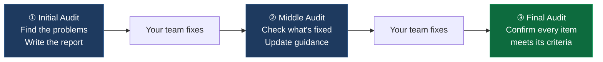

# Source Code Rescue

## Overview

With tools like Cursor, Lovable, Bolt or Claude Code, a founder can go from an idea to a running app in a weekend. For the first few weeks this works well. The AI writes code fast, and most of it does what was asked at the time it was asked.

The trouble shows up later. Each new feature is built on top of code nobody fully read. Fixing one bug breaks two other screens. API keys sit in the frontend. A page that loaded in half a second now takes six, and nobody on the team can say why. At some point the team stops shipping features and spends every week putting out fires.

Source Code Rescue is for that point. We read your codebase, write down every problem we find with the risk it creates and how to fix it, and then either guide your team through the fixes or fix them ourselves.

### Signs your project needs a rescue

- Every release breaks something that used to work
- You are afraid to deploy on a Friday, or on any day
- Nobody on the team can explain how a core flow works end to end
- You have no automated tests, or the tests you have are always failing
- Your cloud bill or page load time keeps climbing and you don't know why
- You are about to raise money and an investor has asked for a technical review

### Best For

- **Founders who built the product themselves with AI tools** and now can't keep up with the bugs
- **Small dev teams** who want an outside senior engineer to tell them what to fix first
- **Startups with real users** where downtime or a data leak now costs money
- **Teams preparing for a fundraise** who need to know what an investor's technical review will find
- **Web2 and Web3** projects, including dApps where a bug can move real funds

---

## Three Ways to Start

| | **Health Check** | **Audit** | **Implement Rescue** |
|---|---|---|---|
| **What it is** | Fast review of your codebase by a Senior Developer | Full audit by a Senior Developer and QA, with 3 review rounds | Audit, then Cyberk developers do the fixes |
| **Who fixes the code** | Your team | Your team, following our guide | Cyberk |
| **You get** | List of critical issues, ranked | Full Audit Report + implementation guide + 3 audit rounds | Audit Report + fixes shipped to your repository |
| **Time** | 48 hours | 3 rounds, paced by your team | Based on the estimate in the Audit Report |
| **Price** | $500 | $5,000 | $5,000 audit + $3,000/month per developer |

Not sure which one you need? Start with the Health Check. After 48 hours you will know whether your project has a few issues your team can handle or problems that need a full audit.

---

## Health Check — $500, 48 hours

A Senior Developer goes through your repository and looks for the issues most likely to hurt you soon: exposed secrets, missing authorization checks, dependencies with known vulnerabilities, and the slowest parts of the code.

You receive a short report listing the critical issues, ranked by severity, with a one-line explanation of the risk for each. The Health Check tells you what is wrong. It does not include step-by-step fixes. That is what the Audit is for.

---

## Audit — $5,000

A Senior Developer reads your code. A QA Engineer uses your app the way a real user would. Together they produce the Audit Report.

We don't touch your code during an Audit. Your team does the fixes, and we check the result over three rounds.

### What we check

| Area | What we look at |
|------|-----------------|
| **Security** | Authentication and authorization, exposed secrets and API keys, injection risks, handling of sensitive data |
| **Architecture & design** | Module structure, duplicated logic, how hard it is to add the next feature |
| **Code quality** | Dead code, copy-pasted blocks, error handling, naming |
| **Performance** | Database queries, N+1 queries, bundle size, caching |
| **Infrastructure & deployment** | Environments, CI/CD, backups, monitoring |
| **Dependencies & third parties** | Outdated or vulnerable packages, vendor lock-in |
| **Data** | Schema, migrations, data integrity |
| **Testing** | Current test coverage and whether the tests actually run |
| **Functional bugs** | Bugs found by QA while using the app, each with steps to reproduce |

### What the Audit Report contains

For every issue we find:

- **What is wrong**, and where it is in the code (file and module)
- **The risk it creates**, written for a non-technical reader. For example: "any logged-in user can read other users' orders", not "missing row-level security".
- **Severity**: Critical, High, Medium or Low
- **How to fix it**, step by step, with code examples where they help. Detailed enough that your developers can do it without us.
- **Acceptance criteria**: how we will check that it is fixed
- **Time estimate** for the fix

The report also answers the question most founders ask first: should we fix this code, or rewrite parts of it? We give a recommendation with the numbers side by side.

### Three audit rounds

1. **Initial Audit.** We find the problems and deliver the Audit Report.
2. **Middle Audit.** We check which items your team has fixed against the acceptance criteria. For items that are not done yet, we explain what is still missing and adjust the guidance if needed.
3. **Final Audit.** We go through every item in the report one last time and confirm which ones are complete.

If your team needs more time after the third round, each extra audit round costs **$2,000**.

---

## Implement Rescue — $3,000/month per developer

For teams without developers, or teams who want the problems gone without pulling their own people off the roadmap.

It starts with the same Audit. Then Cyberk developers work through the report and fix the issues in your repository, starting with the Critical items.

**How long it takes depends on the report.** The Audit Report estimates the total effort. From there we suggest a team size. For example, 6 developer-months of work could be 2 developers for 3 months, or 3 developers for 2 months. You choose based on your budget and how fast you need it done.

**You can try it for one month and cancel anytime.** QA and testing are included in the developer rate.

---

## The Team

| Role | What they do |
|------|--------------|
| **Senior Developer** | Leads the Audit. Reads the code, identifies the problems, writes the solutions and estimates. |
| **QA Engineer** | Tests the running product like a real user, reproduces bugs, and runs the testing process during fixes. |
| **Developer** | Implements the fixes from the Audit Report (Implement Rescue only). |

---

## How It Works

| Step | What happens |
|------|--------------|
| **1. Access** | You give us access to the source code. |
| **2. Health Check** *(optional)* | Results in 48 hours. You decide whether to go further. |
| **3. Audit** | Senior Developer and QA review the code and the running app, then deliver the Audit Report. |
| **4. Fixes** | Your team fixes the issues using the report, or Cyberk developers fix them under Implement Rescue. |
| **5. Middle and Final Audit** | We check each item against its acceptance criteria until the report is closed. |
| **6. Next step** | If you want to keep building with the same team, move to Tech Labs. |

### How we audit in 48 hours

Before a Senior Developer opens your code, Cyberk's internal audit tool scans the whole repository. It checks every file for exposed secrets, known-vulnerable packages, missing authorization checks, slow queries and duplicated logic, and produces a first list of findings.

The Senior Developer then goes through that list: confirms what is real, drops the false alarms, and ranks what is left by the risk to your business. The tool handles the reading and the engineer makes the calls, which is why a Health Check takes 48 hours instead of two weeks, and why the Audit can cover every file instead of a sample.

Everything you receive has been checked by a person. You never get raw output from the tool.

---

## What Source Code Rescue Is Not

- Not a promise of bug-free software. We commit to fixing what is in the report. New features built afterward can bring new bugs.
- Not a new feature build. Rescue fixes what exists. New features belong in Tech Labs or Zero to Product.
- Not an argument against AI coding tools. We use them in our own work. The problems usually come from missing tests and missing review, not from the tools.

---

## After the Rescue

Once the report is closed, most teams want to get back to shipping features. If you want to keep working with the developers who fixed your code, you can move to [Tech Labs](tech-labs.md). They already know your codebase, so there is no ramp-up time.

---

## FAQ

**Q: Our app was built with Lovable, Bolt, v0 or Cursor. Can you work with it?**

Yes, as long as the code lives in a Git repository we can access. If your app is still inside a hosted builder like Lovable or Bolt, export it to GitHub first. We can walk you through that.

**Q: What is the difference between the Health Check and the Audit?**

The Health Check is a fast review by a Senior Developer that tells you what the critical problems are, in 48 hours. The Audit is done by a Senior Developer and a QA Engineer. It covers every area in the table above, explains how to fix each issue step by step, and includes three rounds of checking your team's fixes.

**Q: What do the Middle and Final Audits check?**

Only the issues listed in the Initial Audit Report. New code your team writes between rounds is not part of the review. If you want new code reviewed, that is a new audit.

**Q: What if our team hasn't finished after three rounds?**

You can add more rounds at $2,000 each.

**Q: Do we have to stop building features during the Audit?**

No. Your team can keep working. But every feature built on top of an unfixed issue makes that issue more expensive to fix later. We suggest pausing new features until the Critical items are done.

**Q: How many developers do we need for Implement Rescue, and for how long?**

The Audit Report estimates the total effort, and we suggest a team size from that. A small project may need one developer for a month. A larger one may need several developers for a few months.

**Q: Is QA included in Implement Rescue?**

Yes. The $3,000 per developer per month includes QA and testing.

**Q: Can we try Implement Rescue before committing?**

Yes. Start with one month and cancel anytime.

**Q: Will the app be bug-free after the rescue?**

No, and anyone who promises that is guessing. What we commit to is that every issue in the Audit Report meets its acceptance criteria.

**Q: What if fixing costs more than rewriting?**

Then the report says so, with both numbers side by side. Sometimes rewriting one module is cheaper than patching it. You decide.

**Q: Will I own the code?**

Yes. Every fix goes into your repository. The code, the Audit Report and the documentation are yours.

**Q: What happens after the rescue?**

You can stop there, or move to Tech Labs to keep building with the same developers.
