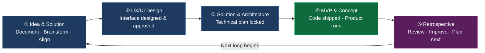

# Zero to Product

## Overview

You have an idea. You don't have a full team, a massive budget, or months to wait. Zero to Product is built for exactly that moment.

For **$5,000/month**, you start your first delivery loop — a structured build cycle covering design, engineering, and architecture — that ships a working product by the end of month one.

This isn't a fixed-scope project. It's a **rolling build rhythm** that maps to how solo founders actually think: the idea evolves, the product learns, and the team adapts.

### Why Zero to Product?

- **From idea to live product — fast.** A weekly delivery cycle means you see real progress every 7 days. No black-box development, no "we'll show you in 2 months."
- **Spend money where it matters.** No bloated team, no wasted hours. Every dollar maps to a concrete deliverable in that week's cycle.
- **Built for iteration.** Your idea will change. Zero to Product is designed for that — each circle resets, refocuses, and ships.
- **Asimov Architect included.** Your product runs on infrastructure battle-tested across 30+ startups — scalable from 0 to 100k users with zero manual intervention.
- **Investor-ready, user-ready.** Every circle produces something you can demo, share, or deploy. Not a deck. Not a prototype. A working product.

---
### Best For

- **Solo founders pre-seed or early-seed** who need a technical team without hiring headaches
- **Founders with an idea but no CTO** — Zero to Product gives you the engineering judgment you'd otherwise need a technical co-founder for
- **Builders who want to reach investors with a working demo** — not slides, not mockups
- **Projects that expect to pivot** — the loop model assumes the idea evolves and plans for it
- **Web2 and Web3** — works for SaaS, marketplaces, DeFi apps, tokenized platforms, mobile apps

---

## The Delivery Loop

Zero to Product runs on **a rhythm, not a calendar.** Each loop is the same 5 steps — the only variable is how long it takes.

A fast loop can close in a day. A full loop wraps in a week. **Same process. Same quality. Different clock.**

At the end of every loop, you have a **working product increment** — not a progress update, not a Figma file. Something that runs. You show it to users. You show it to investors. You make decisions on real feedback, not assumptions.

---
## What's Included

### Core Team (every month)

| Resource | Details |
|----------|---------|
| **Dedicated Developer** | Fullstack developer, good in English, full ownership of the codebase |
| **Design Quota** | UX/UI design for each delivery loop — wireframes, UI screens, component specs |
| **Asimov Architect** | Pre-built, serverless infrastructure. Scales from 0 to 100k users automatically |
| **Weekly Demo** | Every cycle ends with a live demo. You see what's working before the next cycle begins |
| **Retrospective Session** | We sit with you every week to review progress, re-align priorities, and plan the next circle |

### Asimov Architect — What it means for you

Your product is deployed on **Asimov Architect** — Cyberk's serverless infrastructure framework, refined across 30+ client projects:

- **Zero users → minimal cost.** When no one's using the app, you're not paying for idle servers.
- **Traffic spike → auto-scale.** When users arrive (product launch, investor demo, press feature), the system scales without you touching anything.
- **0 to 100k users** — handled without architectural rewrites or emergency DevOps calls.
- **Production-ready from day one.** Your MVP is not a prototype. It's deployable, monitorable, and ready for real traffic.

---

## Pricing

| Plan | Monthly Rate | What You Get |
|------|-------------|-------------|
| **Zero to Product Base** | $5,000/mo | 1 Dedicated Developer + Asimov Architect + Weekly Circles |
| **+ Extra Developer** | +$3,000/mo | Add a second full-stack developer to accelerate feature delivery |
| **+ Smart Contract** | +$4,000/mo | Blockchain/Web3 layer — DeFi, NFT, tokenization, on-chain logic |
| **+ DevOps / Solution Architect** | +$4,000/mo | Senior-level infrastructure, system design, and technical leadership |

**Minimum engagement: 2 months.** Most founders see meaningful product validation by the end of month 1.

**You can add or remove roles month by month.** Start lean, expand when you need more speed.

---

## How a Typical Month Looks

### A Typical Month

| When | What Happens |
|------|-------------|
| **Start of month** | Strategy session with your **Product Lead** — he acts as your CTO, advising on priorities, roadmap direction, and realistic pacing for the month ahead |
| **Every week** | You receive a **Weekly Progress Report** covering all deliverables and milestones you and your Product Lead agreed on — no surprises, no chasing |
| **Every day** | A **live product demo** of what was integrated that day. Can't join live? The team records and sends you the video — you never miss a beat |
| **End of every week** | A **Stress-Test Report** — performance benchmarks, stability measurements, and a health check on every new feature integrated that week |
| **End of month** | A **Monthly Retrospective** — sit down together, review what was built, measure it against the goal, and set direction for the next cycle |

---

## A Typical Day

| Time | What Happens |
|------|--------------|
| **Morning** | Developer sends a **Morning Report** — what was completed yesterday, what's planned today, and a time estimate for each task |
| **Daily Standup** | A 15–30 min session where the developer **shows you the product** — live, running, what was built that day. Not a status update. A demo. |
| **After Standup** | **Asimov AI** auto-generates meeting minutes and task assignments from the call. Sent to you immediately — nothing to follow up on manually. |
| **End of Day** | **Asimov** cross-references all code pushed to the repository against the day's assigned tasks. Full transparency: you can see exactly what was built, what was committed, and whether it maps to the plan. |

If something is off, you'll know by end of day — not end of month.

---

## What Zero to Product Is Not

- Not a fixed-scope project. The scope evolves each cycle by design.
- Not a design-only retainer. Every loop produces running software.
- Not a staffing service. You're engaging Cyberk's full methodology, not renting a developer.

---

## FAQ

**Q: How can the team ship a real product so fast?**

Because we don't start from zero. Cyberk has a pre-built codebase covering the most common product foundations — login & authentication, payment integration, admin dashboard, user management, role-based access control. These are solved problems. The team doesn't rebuild them from scratch — they plug in what exists and focus entirely on your core feature, the thing that actually differentiates your product.

**Q: Is $5,000/month fixed? What exactly does it cover?**

Yes, the base is $5,000/month. This covers one dedicated delivery loop per month: a full-time developer (strong English), a design quota for UX/UI work, the Cyberk serverless architecture setup and hosting configuration, and the structured loop process (planning, demo, retrospective). Any add-ons (extra developer, smart contracts, DevOps) are quoted on top.

**Q: What if my idea isn't fully defined yet?**

That's the point. Step 1 of every delivery loop starts with "Idea & Solution" — we document, brainstorm, and align together. You don't need a PRD or a Figma file to start. You need a direction. We'll help you find the shape of the product as we build it.

**Q: Can I stop after 1 month?**

Minimum is 2 months. After that, you can continue month-by-month with no lock-in. Most founders who see a working product at the end of Month 1 want to keep going — because it's working.

**Q: How is this different from hiring a freelancer?**

A freelancer is a single person. Zero to Product is a system: a proven architecture, a structured delivery loop, and Cyberk's institutional knowledge from 30+ projects. You're not managing a person — you're plugging into an engine.

**Q: What is Asimov Architect?**

Asimov Architect is a software architecture designed by Cyberk specifically for startups. The goal: minimize infrastructure cost in early stage, maximize development speed at every stage.

It runs on serverless services from AWS and Cloudflare — meaning when your app has zero users, you pay near zero in infrastructure costs. No idle servers, no wasted spend. When users arrive and traffic grows, the system scales automatically. You only pay for what you actually use.

For a solo founder, this is the difference between burning $800/month on servers before you have a single user — and paying almost nothing until the product proves itself.

**Q: What tech stack does the developer use?**

Our standard stack: **React / Next.js** (frontend), **Node.js / NestJS** (backend), **AWS / serverless infrastructure**. For Web3: Solidity, Rust, or Move depending on your chain. If your project has specific stack requirements, we discuss fit during onboarding.

**Q: Will I own the code?**

100% yes. Every line of code, every infrastructure config, every design asset — yours. No IP restrictions, no lock-in.

**Q: How do you handle requirement changes without derailing the project?**

Most agencies handle changes badly: you email a request, someone updates a doc, nobody knows what the current version is, and three weeks later you're arguing about whether a feature was "in scope."

We use a different model — inspired by IBM's change management methodology — built into our **Asimov** toolset:

**Evidence → Register → Output**

- **Evidence** — every change request starts with a source: a chat message, a meeting note, a Figma comment, a voice memo. That source is logged as-is, unchanged. This is the ground truth.

- **Register** — the change is then analyzed and added to a live ledger as a structured record. Not a doc edit. A new entry that captures: what exactly is changing, what it affects, whether it conflicts with anything already built or planned. Asimov AI checks automatically for conflicts, duplicates, and downstream impacts. For example — if you ask to remove a feature, instead of deleting it from the spec, a new record is created: "Remove Feature X — affects modules A, B, C — rationale logged." The history is preserved. The impact is visible.

- **Output** — when documentation is needed (for investors, for a new team member, for a milestone review), Asimov reads the full register, filters out superseded and rejected items, and synthesizes the current-state document automatically. You always have an up-to-date spec without anyone maintaining it manually.

The result: you can change your mind freely — and we can implement changes accurately — because every decision has a traceable origin, a clear scope, and no silent overrides.

